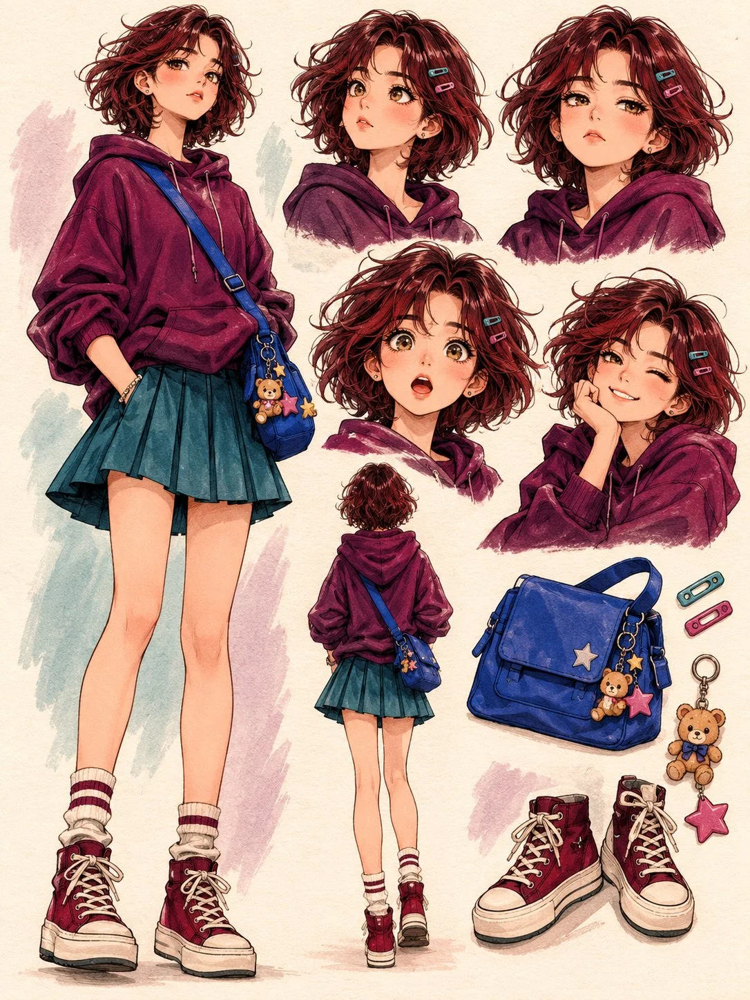

# Anime Character 'Her Own Little World' Concept Art (JSON)

**中文标题：** 动漫角色「她的小世界」概念画（JSON）  
**ID:** `gi25-x-1414` · **Mode:** `generate`  
**Categories:** `general`  
**Tags:** `x-twitter`, `community`, `gpt-image-2.5`, `x-direct`, `en`



### Anime Character 'Her Own Little World' Concept Art (JSON)

```text
{
  "aspect_ratio": "3:4",
  "style": "Premium Japanese anime character concept art, expressive hand-drawn illustration, textured watercolor and colored pencil finish, clean artistic linework, subtle paper grain",
  "prompt": {
    "concept": "Create a beautifully designed ORIGINAL fictional anime girl character exploration sheet on a warm pale ivory paper background. The character must have a completely original appearance and personality, not resembling any existing character or reference design.",

    "main_character": {
      "description": "A cute but effortlessly cool teenage girl.",
      "hair": "Short, fluffy dark auburn hair with slightly messy side bangs.",
      "eyes": "Large expressive hazel eyes.",
      "facial_features": "Soft rosy cheeks.",
      "outfit": {
        "hoodie": "Deep plum oversized hoodie with rolled sleeves.",
        "skirt": "Muted teal pleated skirt.",
        "socks": "Cream striped socks.",
        "shoes": "Chunky burgundy high-top sneakers.",
        "bag": "Small cobalt-blue crossbody messenger bag with unusual little decorative charms."
      },
      "design_goal": "Give her a recognizable silhouette and appealing proportions."
    },

    "composition": {
      "layout": "Create an artistic character design board with an interesting asymmetrical arrangement, not a rigid symmetrical grid.",

      "left_side": {
        "element": "One large full-body illustration.",
        "pose": "The girl stands casually with one hand inside her hoodie pocket, slightly tilted head and confident relaxed expression.",
        "priority": "Make this the dominant focal point."
      },

      "top_right": {
        "element": "Three smaller head-and-shoulder character studies.",
        "expressions": [
          "Curious side glance",
          "Unimpressed expression",
          "Sleepy half-closed eyes"
        ]
      },

      "middle_right": {
        "element": "Two expressive close-up portraits.",
        "expressions": [
          "Genuinely surprised open-mouth expression",
          "Playful mischievous smile"
        ]
      },

      "lower_center": {
        "element": "Full back-view illustration.",
        "details": "Clearly show her hoodie, hairstyle, skirt and messenger bag design."
      },

      "lower_right": {
        "element": "Small collection of beautifully illustrated character accessories.",
        "accessories": [
          "Messenger bag",
          "Sneakers",
          "Hair clips",
          "Tiny keychain charms"
        ],
        "arrangement": "Arrange them naturally like an artist's design exploration."
      }
    },

    "color_direction": {
      "palette": [
        "Deep plum",
        "Muted teal",
        "Dusty rose",
        "Warm cream",
        "Burgundy"
      ],
      "description": "Use a distinctive sophisticated palette with strong contrast between clothing colors, beautiful skin tones and rich but controlled color saturation."
    },

    "art_direction": {
      "poses": "Make every pose feel different and full of personality.",
      "proportions": "Natural proportions and expressive eyes.",
      "clothing": "Beautifully designed clothing folds and charming small details.",
      "illustration": "Confident hand-drawn brushwork and subtle sketch marks.",
      "final_result": "A professionally illustrated character artbook page, visually rich but uncluttered."
    },

    "consistency": [
      "Maintain exactly the same character identity across every illustration.",
      "Keep the same face, hairstyle and outfit in every view.",
      "No copied character designs.",
      "No duplicated poses.",
      "No unnecessary decorative elements."
    ]
  },

  "negative_prompt": "Any text, letters, typography, words, titles, captions, labels, numbers, signatures, watermarks, logos, readable writing, speech bubbles, reference character resemblance, yellow beanie, black bob haircut, green bomber jacket, copied composition, repetitive expressions, identical poses, extra characters, inconsistent clothing, face changes, deformed hands, extra fingers, distorted anatomy, messy background, excessive decoration, photorealism, 3D render.",

  "quality": "Highly detailed, polished professional anime illustration, beautiful color harmony, crisp character details"
}
```

- **Recommended model:** `gpt-image-2.5-sunburst`
- **Settings:** _(defaults)_
- **Source:** [community](https://x.com/Just_Anika_Here/status/2118193283377889591) — @Just_Anika_Here
- **License note:** Original public X post; quoted with attribution — remix with attribution
- **Notes:** Collected directly from X; original post https://x.com/Just_Anika_Here/status/2118193283377889591; post text names GPT Image 2.5; discovered via X search, prompt re-verified against the original X post via api.fxtwitter.com; verified=True; JSON-structured prompt
- **Preview:** `previews/gi25-x-1414.webp`
