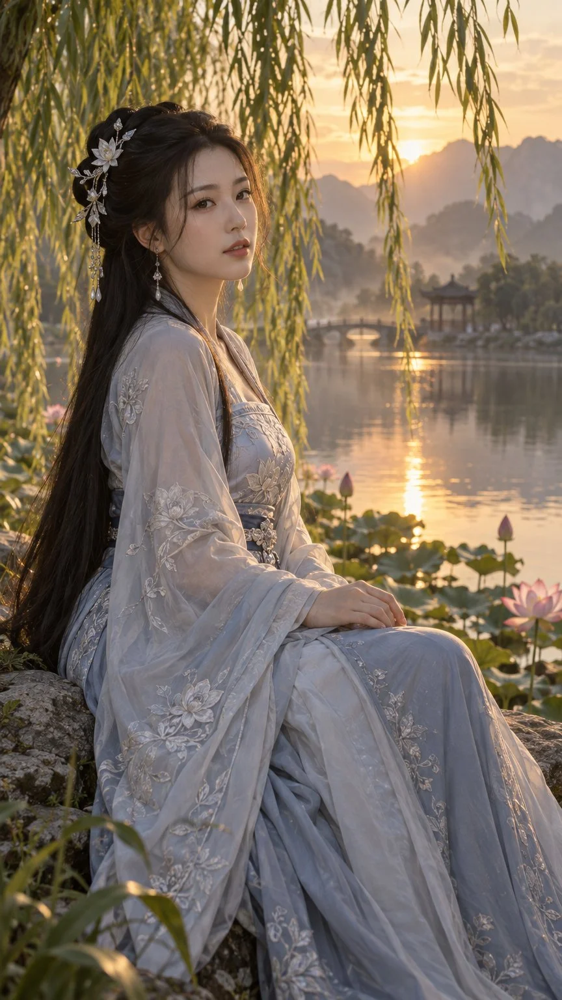

# East Asian Fantasy Portrait with Embroidery Detail

**中文标题：** 东亚奇幻刺绣细节人像  
**ID:** `gi25-x-1428` · **Mode:** `generate`  
**Categories:** `general`  
**Tags:** `x-twitter`, `community`, `gpt-image-2.5`, `x-direct`, `en`



### East Asian Fantasy Portrait with Embroidery Detail

```text
An original cinematic semi-realistic fantasy portrait of a clearly adult East Asian woman, age 28, seated on a lakeside stone beneath trailing willow branches at golden hour. Long black hair with delicate pale lotus ornaments, elegant silver-blue embroidered silk hanfu with opaque bodice and modest neckline, airy outer sleeves, long skirt naturally draped over her legs. Three-quarter seated composition, vertical 9:16 framing. Warm golden backlight through leaves, soft mist, distant mountain silhouettes, a tranquil reflective pond and small pink lotus blossoms. Natural skin texture, individual hair strands, intricate silver embroidery, believable hands and anatomy, soft atmospheric depth. No text, no watermark, no logos.
```

- **Recommended model:** `gpt-image-2.5-sunburst`
- **Settings:** _(defaults)_
- **Source:** [community](https://x.com/fengnian_ai/status/2118386725676552194) — @fengnian_ai
- **License note:** Original public X post; quoted with attribution — remix with attribution
- **Notes:** Collected directly from X; original post https://x.com/fengnian_ai/status/2118386725676552194; post text names GPT Image 2.5; discovered via X search, prompt re-verified against the original X post via api.fxtwitter.com; verified=True; comparison post (left GPT Image 2.6, right 2.5); preview is image 2, the GPT Image 2.5 result
- **Preview:** `previews/gi25-x-1428.webp`
