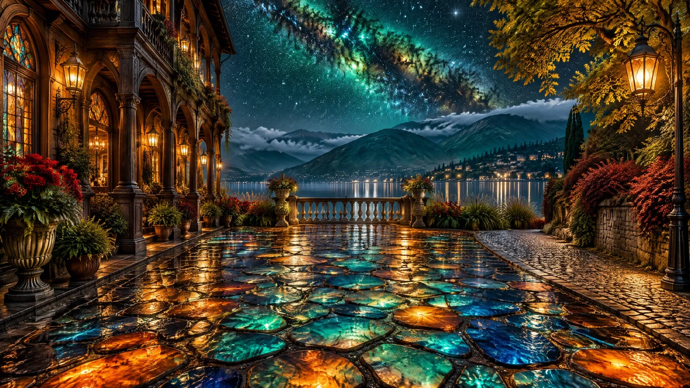

# Magical Lakeside Promenade with Lights Underfoot

**中文标题：** 脚下生光的魔法湖畔长廊  
**ID:** `gi25-x-1430` · **Mode:** `generate`  
**Categories:** `general`  
**Tags:** `x-twitter`, `community`, `gpt-image-2.5`, `x-direct`, `en`



### Magical Lakeside Promenade with Lights Underfoot

```text
Photorealistic magical lakeside promenade at night, wide 16:9 panoramic composition, cinematic, ultra-detailed. Edge to edge, no frame, no border.

PATH: the whole foreground is a broad walkway of irregular flagstones in dark joints, and every stone glows from within like stained glass or opal, molten orange bleeding into turquoise, emerald and cobalt, then deep midnight blue, each a separate luminous cell with wet cracks and bright glossy highlights. The path recedes in strong one-point perspective toward a stone balustrade at the centre.

LEFT: a tall ornate wooden facade fills the left third, dark carved timber with a deep arcaded loggia, slender columns and balconies, glowing lantern sconces mounted along the wall, stained-glass windows, urns of plants and pots of red flowers at its base.

RIGHT: a lane of pale patterned cobbles and a hanging lamp post with a lit lantern at the near right. Behind it a leafy tree with warm green-gold autumn foliage arches over the path, and crimson and rust shrubs crowd the verge.

BALUSTRADE: at the centre a low stone balustrade with turned balusters separates the path from the water, flanked by flowering borders and tall grasses.

LAKE: a broad dark lake lies beyond, its surface streaked with pale blue and gold reflection, the far shore dissolving into haze.

HILLS: across the lake rise soft forested hills in deep teal green, ridges receding into mist, a pale band of white cloud low along their tops.

SKY: the upper half is a star-filled night vault, seething with a vast emerald-green and turquoise nebula twisting diagonally across the centre, threaded with dust lanes and gold-brown star clouds, scattered with hundreds of fine white stars.

PALETTE: emerald, turquoise, cobalt, molten orange, amber, warm brown, near-black shadow, pale starlight. Sharp focus, glossy wet highlights, high dynamic range, clean and unmarked
```

- **Recommended model:** `gpt-image-2.5-sunburst`
- **Settings:** _(defaults)_
- **Source:** [community](https://x.com/churvikv/status/2118443408251347011) — @churvikv
- **License note:** Original public X post; quoted with attribution — remix with attribution
- **Notes:** Collected directly from X; original post https://x.com/churvikv/status/2118443408251347011; post text names GPT Image 2.5; discovered via X search, prompt re-verified against the original X post via api.fxtwitter.com; verified=True; made with GPT Image 2.5 Sunburst on Dreamina
- **Preview:** `previews/gi25-x-1430.webp`
