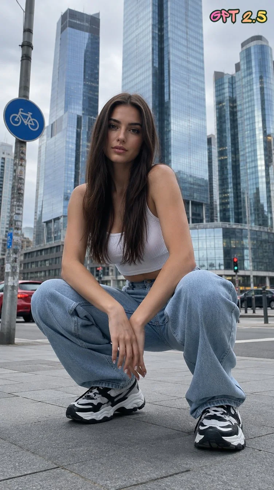

# Urban Fashion Sidewalk Crouch Editorial

**中文标题：** 都市时尚人行道蹲姿编辑人像  
**ID:** `gi25-x-1431` · **Mode:** `generate`  
**Categories:** `general`  
**Tags:** `x-twitter`, `community`, `gpt-image-2.5`, `x-direct`, `en`



### Urban Fashion Sidewalk Crouch Editorial

```text
Ultra-realistic high-end urban fashion editorial photography of a beautiful young adult woman with long, straight dark brown hair, crouching naturally on a city sidewalk in a modern metropolitan business district.

She wears a fitted white ribbed sleeveless crop top, light blue loose-fit jeans and contemporary black-and-white chunky sneakers.

POSE & COMPOSITION:
Deep natural squat pose, both feet firmly grounded, knees bent, hands relaxed between her legs. Torso slightly leaning forward, looking directly into the camera with a calm, confident expression. Full-body composition, low-angle perspective.
ENVIRONMENT:
Impressive contemporary glass skyscrapers with reflective blue-grey windows, urban street intersection, subtle traffic, a red car partially visible, pavement tiles and a circular bicycle traffic sign on a pole to the left. Authentic European metropolitan atmosphere.

LIGHTING:
Soft natural overcast daylight, diffused cinematic lighting, realistic skin tones, subtle atmospheric haze, muted cool grey-blue color palette.
CAMERA:
Full-frame camera, 35mm lens, f/2.8, natural depth of field, sharp focus on the subject.

AESTHETIC:
Luxury fashion campaign meets candid street-style photography, contemporary editorial magazine aesthetic, authentic spontaneous moment, sophisticated urban atmosphere, premium color grading, realistic skin texture, natural anatomy, photorealistic, 8K quality.
```

- **Recommended model:** `gpt-image-2.5-sunburst`
- **Settings:** _(defaults)_
- **Source:** [community](https://x.com/AJMorales73/status/2118459891786682510) — @AJMorales73
- **License note:** Original public X post; quoted with attribution — remix with attribution
- **Notes:** Collected directly from X; prompt posted as the author's own reply https://x.com/AJMorales73/status/2118459891786682510 to https://x.com/AJMorales73/status/2118459887856308360, which carries the images; GPT Image 2.5 is named in the parent post; discovered via X search, prompt re-verified against the original X post via api.fxtwitter.com; verified=True; comparison experiment (2.5 vs 2.6); prompt from author's reply; preview is image 1 of the parent post
- **Preview:** `previews/gi25-x-1431.webp`
