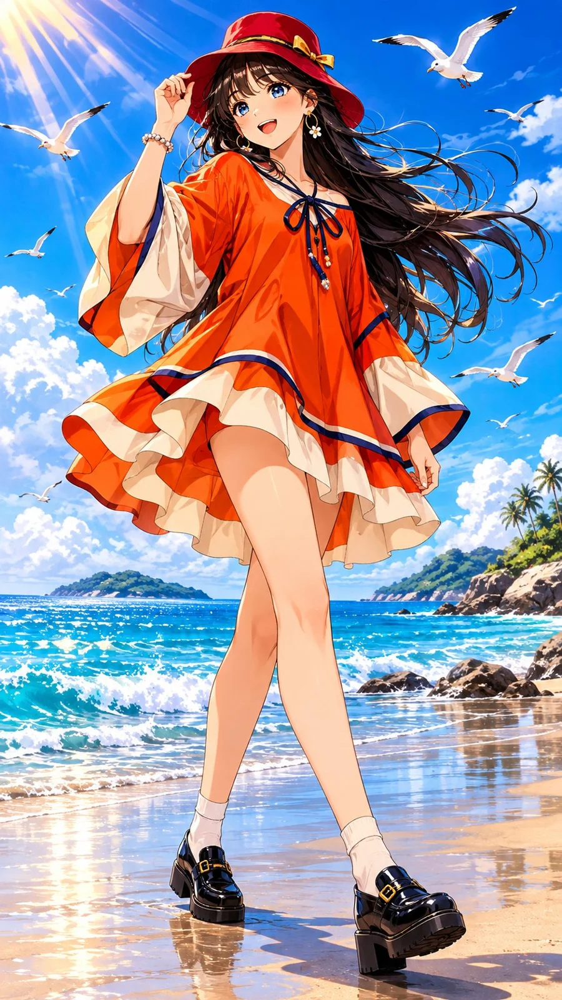

# Tropical Ocean Anime Girl Summer Portrait (JSON, 9:16)

**中文标题：** 热带海边动漫少女夏日写真（JSON·9:16）  
**ID:** `gi25-x-1432` · **Mode:** `generate`  
**Categories:** `general`  
**Tags:** `x-twitter`, `community`, `gpt-image-2.5`, `x-direct`, `en`



### Tropical Ocean Anime Girl Summer Portrait (JSON, 9:16)

```text
{
  "aspect_ratio": "9:16",
  "style": "Premium Japanese anime illustration, vibrant summer movie aesthetic, expressive hand-drawn character art, high-contrast cel shading, brilliant tropical colors",

  "prompt": "Create an exceptionally beautiful, vibrant Japanese anime summer illustration featuring an original stylish anime girl enjoying a sunny day at a spectacular tropical beach.\n\nCHARACTER: A beautiful young anime girl with long, flowing jet-black hair, slightly layered with loose strands blowing dramatically in the sea breeze. Her hair has subtle warm orange sunlight reflections near the ends. She has large sparkling electric-blue eyes, delicate facial features, naturally rosy cheeks, a tiny nose and a charming confident smile. Her expression is playful, relaxed and full of personality.\n\nOUTFIT: A fashionable oversized vibrant coral-orange and warm ivory asymmetric summer tunic dress. The main fabric is rich, saturated sunset-orange with bold ivory-white contrasting panels along the wide dramatic sleeves, collar and layered flowing hemline. Add subtle deep navy decorative piping and stylish fabric details. The dress must create a strong visual contrast against the blue ocean and sky. A fashionable deep cherry-red bucket hat with a small golden decorative ribbon. Black chunky platform loafers and delicate ivory ankle socks. The outfit should feel youthful, fashionable, premium and visually striking.\n\nPOSE: Full-body dynamic fashion pose, captured mid-step while walking along the wet shoreline. One leg steps forward confidently, the other remains behind, creating a beautiful diagonal body composition. Her upper body turns slightly toward the viewer, her head tilts playfully, and one hand gently holds the edge of her flowing hat. Her long hair and oversized dress billow dramatically in the ocean breeze. Natural, stylish and effortlessly cool body language.\n\nENVIRONMENT: A breathtaking tropical beach with crystal-clear turquoise water, deep cobalt-blue ocean in the distance, sparkling waves crashing against the shore, wet reflective sand, scattered smooth rocks and distant islands. Several beautiful white seagulls fly dynamically across the sky at different distances. Tiny ocean droplets sparkle in the sunlight.\n\nSKY AND LIGHTING: A brilliant saturated blue summer sky with delicate white clouds. Strong diagonal golden sunbeams enter from the upper left, creating beautiful lens-like light rays, luminous hair highlights and dramatic shadows across the beach. Intense sunlight reflects beautifully from the ocean surface.\n\nCOLOR PALETTE: Vibrant sunset coral-orange, warm ivory, deep cherry red, rich navy, electric cobalt blue, brilliant turquoise and golden sunlight. The character's clothing must use warm colors that strongly contrast with the cool blue tropical beach environment. Absolutely avoid blue, cyan, turquoise or aqua shades in the clothing. Strong complementary color contrast, luminous highlights and deep clean shadows.\n\nCOMPOSITION: Vertical 9:16 full-body illustration. Show the complete character from the top of her hat to both shoes without cropping. Character occupies approximately 65 percent of the frame. Slightly low camera angle, dynamic perspective, beautiful foreground shadows and expansive ocean background. Keep her face clearly visible and the entire silhouette beautifully separated from the background.\n\nARTISTIC QUALITY: Exceptional Japanese anime movie illustration, sophisticated hand-drawn linework, beautifully detailed expressive eyes, flowing individual hair strands, refined cel shading, dramatic fabric movement, painterly ocean reflections, sparkling water highlights, crisp details and premium animation-art finish.\n\nMOOD: Energetic, carefree, stylish, refreshing, youthful and magical. A spectacular summer beach moment that feels like an iconic frame from a beautifully animated Japanese movie.\n\nMake the final artwork visually stunning, highly detailed, colorful, clean and professionally composed.",

  "negative_prompt": "photorealistic, 3D render, CGI, dull colors, washed-out colors, grey sky, muddy palette, flat lighting, blue clothing, cyan clothing, turquoise clothing, aqua dress, outfit blending into background, boring pose, stiff posture, cropped body, cut-off feet, missing shoes, close-up portrait, distorted face, asymmetrical eyes, bad anatomy, extra fingers, extra limbs, deformed hands, unnatural legs, tangled hair, duplicate birds, messy background, text, typography, watermark, logo, border"
}
```

- **Recommended model:** `gpt-image-2.5-sunburst`
- **Settings:** _(defaults)_
- **Source:** [community](https://x.com/Just_Anika_Here/status/2118558448376004861) — @Just_Anika_Here
- **License note:** Original public X post; quoted with attribution — remix with attribution
- **Notes:** Collected directly from X; original post https://x.com/Just_Anika_Here/status/2118558448376004861; post text names GPT Image 2.5; discovered via X search, prompt re-verified against the original X post via api.fxtwitter.com; verified=True; JSON-structured prompt
- **Preview:** `previews/gi25-x-1432.webp`
