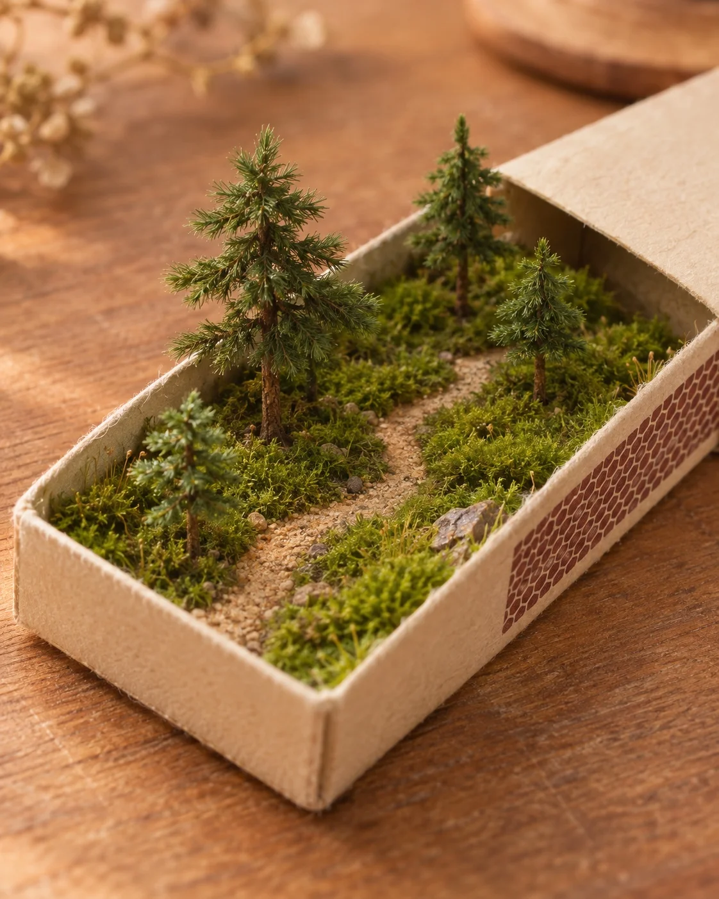

# Matchbox Miniature Worlds (Moss Pine Path)

**中文标题：** 火柴盒里的小世界·苔藓松林小径  
**ID:** `gi25-x-1434` · **Mode:** `generate`  
**Categories:** `general`  
**Tags:** `x-twitter`, `community`, `gpt-image-2.5`, `x-direct`, `zh`



### Matchbox Miniature Worlds (Moss Pine Path)

```text
Create an image with the following visual system. Replace the subject as specified.

Visual system (light, color, composition, medium, mood):
一张约 1:1 到 4:5 的微缩手作实拍特写：一只打开的纸质火柴盒托盘斜放在暖色木桌面上，托盘里塞进一整片可更换的微缩景观。机位略高的三分之四俯视，火柴盒落在画面中下部，长边从左下往右上斜切；前景木纹与远景虚化，浅景深，焦点落在微缩景物与盒口边缘。柔和自然侧光从左侧进来，暖色温，树或景物背面有浅而软的接触阴影，不要硬闪光。火柴盒是米白/米黄卡纸，一侧可见红褐蜂窝状划火面；木桌面是蜜色到浅胡桃的暖木纹。微缩材质必须看得出手作：苔藓绒面、细沙、迷你树针叶、纸板边缘纤维，不要光滑塑料玩具感，也不要超写实 CGI。配色以暖木棕、米黄卡纸、景观本色为主；景观内部可换季节色，但整体仍压在柔和暖调里。画面没有任何文字、品牌、商标或可读字母。安静、小巧、像桌上随手拍的手作微缩。

New subject:
苔藓松林小径：托盘里铺满厚实翠绿苔藓，一条细沙土色弯曲小径从近端延伸到远端，四棵高低不一的迷你针叶松，深绿针叶、细棕树干。画面中没有文字。
```

- **Recommended model:** `gpt-image-2.5-sunburst`
- **Settings:** _(defaults)_
- **Source:** [community](https://x.com/static_stare/status/2118564450454163553) — @static_stare
- **License note:** Original public X post; quoted with attribution — remix with attribution
- **Notes:** Collected directly from X; original post https://x.com/static_stare/status/2118564450454163553; post text names GPT Image 2.5; discovered via X search, prompt re-verified against the original X post via api.fxtwitter.com; verified=True; prompt for image 1 of 4 (the author shares the other three on request); preview is image 1
- **Preview:** `previews/gi25-x-1434.webp`
