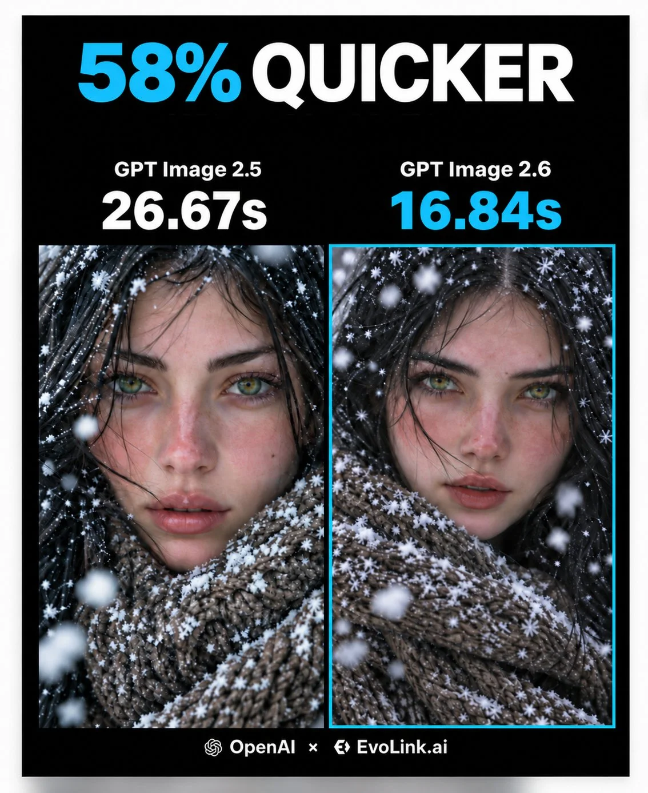

# Photoreal Winter Porcelain Portrait (JSON)

**中文标题：** 写实冬日瓷感人像（JSON）  
**ID:** `gi25-x-1435` · **Mode:** `generate`  
**Categories:** `general`  
**Tags:** `x-twitter`, `community`, `gpt-image-2.5`, `x-direct`, `en`



### Photoreal Winter Porcelain Portrait (JSON)

```text
{
  "prompt_structure": {
    "subject": {
      "demographics": "Young woman, mid-20s",
      "facial_features": {
        "skin": "Pale porcelain skin with visible natural texture, pores, and light freckles. Rosy flushed cheeks and nose indicating cold temperature. Hyper-realistic skin details.",
        "eyes": "Striking hazel-green irises, sharp focus, direct eye contact. Long eyelashes catching tiny white snowflakes and frost particles.",
        "hair": "Jet black, straight hair, slightly windblown with loose strands crossing the face. Sprinkled with fresh white snowflakes.",
        "expression": "Neutral to soft allure, lips slightly parted, serene and intimate."
      }
    },
    "attire_and_styling": {
      "clothing": "Chunky, coarse-knit wool scarf or high-collar sweater in brownish-grey earth tones.",
      "texture_details": "Fabric fibers visible, accumulation of fresh, fluffy snow on the knitwear.",
      "makeup": "Minimalistic 'no-makeup' look, natural lip color, emphasis on natural flush."
    },
    "environment": {
      "setting": "Outdoor winter scene, snowy day.",
      "atmosphere": "Falling snow, cold air, ethereal winter vibe.",
      "foreground_elements": "Large, out-of-focus snowflakes (bokeh) floating close to the lens."
    },
    "lighting": {
      "type": "Soft, diffuse natural overcast light.",
      "quality": "Even illumination, no harsh shadows, soft catchlights in eyes.",
      "color_tone": "Cool tones with contrasting warm skin flush."
    },
    "camera_settings": {
      "shot_type": "Extreme close-up portrait (macro focus on eyes).",
      "lens": "85mm or 105mm portrait lens.",
      "aperture": "f/1.8 to f/2.8 (shallow depth of field).",
      "focus": "Razor-sharp focus on irises and eyelashes, blurred foreground snow and background.",
      "style": "Cinematic photography, high resolution, 8k."
    },
    "technical_modifiers": [
      "Ultra Photorealistic",
      "Unreal Engine 5 render style",
      "Subsurface scattering",
      "Volumetric lighting",
      "Ray tracing",
      "Fine art portrait",
      "Detailed texture",
      "Raw photo"
    ],
    "mood": "Intimate, serene, chilly, ethereal, captivating."
  }
}
```

- **Recommended model:** `gpt-image-2.5-sunburst`
- **Settings:** _(defaults)_
- **Source:** [community](https://x.com/EvoLinkAi/status/2118576613067735493) — @EvoLinkAi
- **License note:** Original public X post; quoted with attribution — remix with attribution
- **Notes:** Collected directly from X; prompt posted as the author's own reply https://x.com/EvoLinkAi/status/2118576613067735493 to https://x.com/EvoLinkAi/status/2118576611989884929, which carries the images; GPT Image 2.5 is named in the parent post; discovered via X search, prompt re-verified against the original X post via api.fxtwitter.com; verified=True; comparison post (2.5 vs 2.6); prompt from author's reply; preview is image 1 of the parent post
- **Preview:** `previews/gi25-x-1435.webp`
