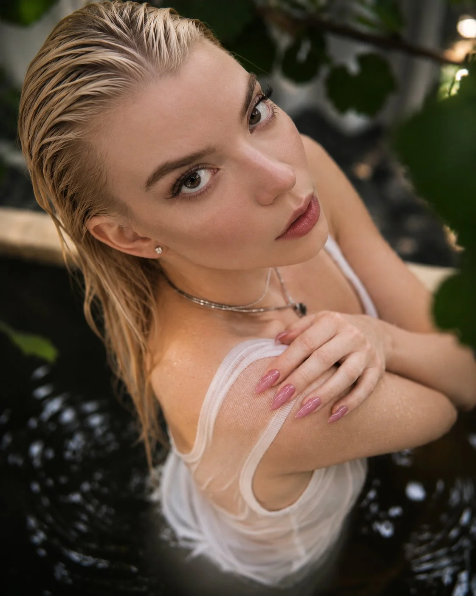

# Overhead Dark-Water Luxury Beauty Editorial (3:4)

**中文标题：** 俯拍暗水奢华美妆编辑人像（3:4）  
**ID:** `gi25-x-1442` · **Mode:** `generate`  
**Categories:** `general`  
**Tags:** `x-twitter`, `community`, `gpt-image-2.5`, `x-direct`, `en`



### Overhead Dark-Water Luxury Beauty Editorial (3:4)

```text
Ultra-photorealistic luxury beauty editorial photograph of a stunning young adult brunette woman relaxing in dark, crystal-clear water, captured from a dramatic overhead three-quarter angle.

Face & Beauty: Beautiful naturally symmetrical facial structure, expressive hazel-green eyes, softly defined cheekbones, delicate straight nose, naturally full lips, subtle freckles, realistic skin pores, warm glowing complexion, elegant natural makeup, long eyelashes.

Hair: Dark brunette hair slicked back and wet, with individual damp strands flowing naturally around her head and shoulders.

Pose: Her head tilted slightly backward, looking directly upward into the camera with an alluring, confident expression. One arm gently wrapped across her shoulder, elegant fingers with glossy rose-pink almond-shaped nails.

Outfit & Accessories: Minimal white ribbed tank top, delicate layered silver necklaces, tiny diamond stud earrings.

Environment: Dark reflective water surrounding her body, gentle ripples, tiny water droplets on her skin, blurred tropical green foliage around the edges, intimate outdoor atmosphere.

Lighting: Warm golden-hour reflections, soft directional natural light, realistic skin highlights, subtle cinematic shadows.

Camera: Hasselblad medium-format photography, 85mm portrait lens, f/2.0, shallow depth of field, authentic optical rendering, exquisite photographic detail.

Style: High-end fashion editorial, luxury beauty campaign, authentic magazine photography, cinematic color grading, realistic human anatomy, natural skin texture.

Negative prompt: CGI, 3D render, illustration, artificial skin, plastic face, excessive retouching, distorted hands, extra fingers, unnatural eyes, over-sharpening.

Vertical 3:4 composition, ultra-realistic photographic quality.
```

- **Recommended model:** `gpt-image-2.5-sunburst`
- **Settings:** _(defaults)_
- **Source:** [community](https://x.com/Ankit_patel211/status/2119438138447888742) — @Ankit_patel211
- **License note:** Original public X post; quoted with attribution — remix with attribution
- **Notes:** Collected directly from X; original post https://x.com/Ankit_patel211/status/2119438138447888742; post text names GPT Image 2.5; discovered via X search, prompt re-verified against the original X post via api.fxtwitter.com; verified=True; made on ImagineArt; the post's caption lines before the prompt are omitted; the prompt itself names no real person
- **Preview:** `previews/gi25-x-1442.webp`
