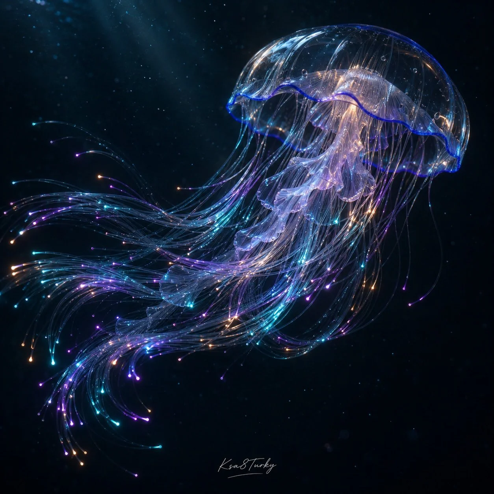

# Surreal Tech-Material Nature Editorial (Fiber-Optic Jellyfish)

**中文标题：** 超现实科技材质自然编辑图（光纤水母）  
**ID:** `gi25-x-1447` · **Mode:** `generate`  
**Categories:** `general`  
**Tags:** `x-twitter`, `community`, `gpt-image-2.5`, `x-direct`, `en`



### Surreal Tech-Material Nature Editorial (Fiber-Optic Jellyfish)

```text
Create a square surreal technology editorial photograph of [NATURAL FORM] reimagined using [TECH MATERIAL]. Example: one jellyfish with a clear glass bell and delicate fiber-optic tentacles glowing cyan, violet and amber in deep midnight water. Keep its silhouette recognizable and material unmistakable. Coherent geometry, cinematic low-key light, realistic refraction and dark negative space. No people, brands or headline. Small handwritten Ksa8Turky at bottom center.
```

- **Recommended model:** `gpt-image-2.5-sunburst`
- **Settings:** _(defaults)_
- **Source:** [community](https://x.com/ksa8Turky/status/2119262381167755494) — @ksa8Turky
- **License note:** Original public X post; quoted with attribution — remix with attribution
- **Notes:** Collected directly from X; original post https://x.com/ksa8Turky/status/2119262381167755494; post text names GPT Image 2.5; discovered via X search, prompt re-verified against the original X post via api.fxtwitter.com; verified=True; fill-in template for [NATURAL FORM] / [TECH MATERIAL]; ends with the author's handwritten signature line
- **Preview:** `previews/gi25-x-1447.webp`
