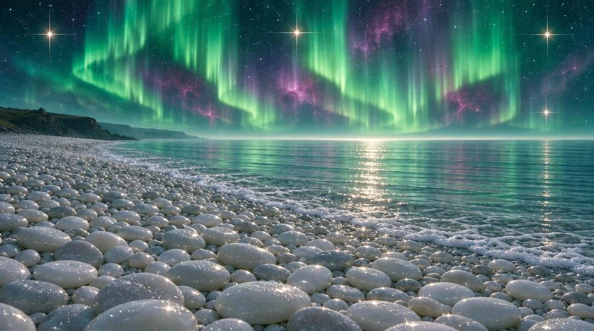

# Aurora Night Seascape over a Pebble Beach (16:9)

**中文标题：** 极光夜海与鹅卵石海滩（16:9）  
**ID:** `gi25-x-1448` · **Mode:** `generate`  
**Categories:** `general`  
**Tags:** `x-twitter`, `community`, `gpt-image-2.5`, `x-direct`, `en`



### Aurora Night Seascape over a Pebble Beach (16:9)

```text
Photorealistic magical seascape at night, wide 16:9 panoramic composition, ultra-detailed. Full bleed, no frame, no border, no lettering.
SKY: a deep teal-green and indigo night sky fills the upper half, swept with tall vertical curtains of aurora borealis in luminous mint, emerald and pale jade, their strands hanging like combed light. Behind them glow soft magenta, rose and violet nebula clouds. Hundreds of fine white stars speckle the dark, and four bright four-point starburst stars with long cross flares burn at the left, centre, right and lower right. A pale glow swells along the horizon line where sky meets sea.
HORIZON: a low dark rocky headland silhouette sits at the far left, softened by haze, with faint distant cliffs behind it. The rest of the horizon is a soft silver-blue fog band.
SEA: the right half is calm glassy water in pale silvery-teal and grey-mint, marked with fine horizontal ripple lines. A bright path of glittering light runs down the surface toward the shore, dotted with sharp white sparkles, and a soft foam edge of small bubbles traces the waterline where it meets the stones.
BEACH: the entire foreground and lower two-thirds is a vast beach of smooth rounded pebbles, thousands of them, in cream white, pale grey and soft pearl, packed tightly in rounded mounds and shallow sweeping curves that lead the eye from the bottom edge toward the water. Each stone is polished and softly lit from above, wet with salt sheen, some with bright specular highlights and sprinkles of tiny white dots like frost or salt crystals.
LIGHT: cool silver-blue moonlight mixed with the green aurora glow, soft and diffuse, with a warm sparkle only in the star flares and the water highlights.
PALETTE: deep teal, emerald, jade mint, dark indigo, magenta violet, silver grey, pearl white. Luminous, dreamlike, tranquil, high dynamic range.
```

- **Recommended model:** `gpt-image-2.5-sunburst`
- **Settings:** _(defaults)_
- **Source:** [community](https://x.com/churvikv/status/2119205952645632300) — @churvikv
- **License note:** Original public X post; quoted with attribution — remix with attribution
- **Notes:** Collected directly from X; original post https://x.com/churvikv/status/2119205952645632300; post text names GPT Image 2.5; discovered via X search, prompt re-verified against the original X post via api.fxtwitter.com; verified=True; made on Somake with GPT Image 2.5 Sunburst
- **Preview:** `previews/gi25-x-1448.webp`
