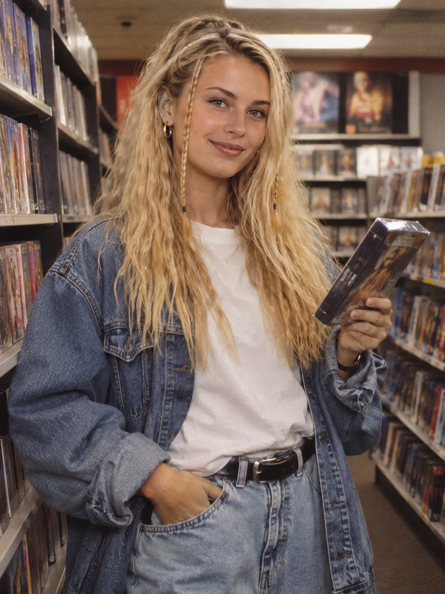

# Early-90s Video Rental Store Portrait (3:4)

**中文标题：** 90年代初录像带租赁店人像（3:4）  
**ID:** `gi25-x-1449` · **Mode:** `generate`  
**Categories:** `general`  
**Tags:** `x-twitter`, `community`, `gpt-image-2.5`, `x-direct`, `en`



### Early-90s Video Rental Store Portrait (3:4)

```text
Style: Ultra-realistic 1990s nostalgic photography, fluorescent store light, soft film grain.
Main Prompt: Create an image of a model with long crimped blonde hair and two thin face-framing braids, wearing an oversized denim jacket, a plain white tee, baggy light-wash jeans and chunky sneakers, standing between tall shelves of video cassettes in a retro rental store. Holding one cassette case in her hand, playful smile at the camera. Waist-up. Vertical portrait format 3:4.
Negative Prompt: no text, no readable titles, no watermark, no extra fingers, no logos.
```

- **Recommended model:** `gpt-image-2.5-sunburst`
- **Settings:** _(defaults)_
- **Source:** [community](https://x.com/antrospike/status/2119147390452355576) — @antrospike
- **License note:** Original public X post; quoted with attribution — remix with attribution
- **Notes:** Collected directly from X; original post https://x.com/antrospike/status/2119147390452355576; post text names GPT Image 2.5; discovered via X search, prompt re-verified against the original X post via api.fxtwitter.com; verified=True; style / main / negative prompt structure
- **Preview:** `previews/gi25-x-1449.webp`
