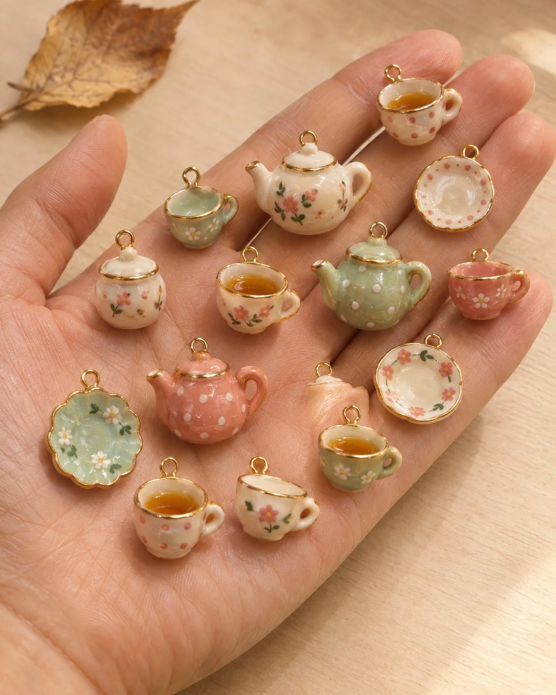

# Handmade Ceramic Charms in an Open Palm (Mini Teacups)

**中文标题：** 掌心手作陶瓷小挂件（迷你茶杯）  
**ID:** `gi25-x-1459` · **Mode:** `generate`  
**Categories:** `general`  
**Tags:** `x-twitter`, `community`, `gpt-image-2.5`, `x-direct`, `zh`



### Handmade Ceramic Charms in an Open Palm (Mini Teacups)

```text
Create an image with the following visual system. Replace the subject as specified.

Visual system (light, color, composition, medium, mood):
一张竖幅约 4:5 的手作陶瓷小挂件实拍：一只摊开的手掌从左下斜伸入画面，掌心朝上占画面中下大半，掌心和几根手指上松散摆着十几枚可整体替换的迷你釉彩陶瓷挂件，每枚约指甲盖大小，顶端带一枚细小金色挂环，彼此互不重叠、疏密自然，指缝间留一点空隙。机位约 45 度俯拍略斜，焦点落在掌心中央那几枚挂件上，边缘挂件和背景轻微虚化。背景是一张摊开的奶油米色素纸或浅木桌面，只作浅底，不出现任何可读文字；一角可放一片干枯落叶做前景点缀。光线是窗边柔和侧光，从右上进入，色温偏暖，每枚挂件釉面有小而柔的高光点，挂件在掌心投下浅暖灰的短阴影，不要硬闪光。材质：手捏陶瓷小坯体，表面厚涂玻璃釉，手绘小斑点、细线条和金边描边，轮廓略不规整，看得出手作痕迹，拒绝塑料、树脂或 3D 渲染感；手掌皮肤纹理真实自然。配色：暖肤色与奶油纸底占大面，挂件以珊瑚橘、奶白、焦糖棕、芥末黄为主，少量金色点缀。画面无品牌、无商标、无水印、无可读文字。温暖、手作、像工作室里刚把一把新烧好的小挂件倒在手上拍一张。

New subject:
迷你茶杯挂件：十几枚迷你茶杯、带盖小茶壶、小茶碟和一只小糖罐，釉色在奶白、薄荷绿、珊瑚粉之间轮换，杯沿和壶嘴描一圈细金线，几只杯子里有一小汪琥珀色茶釉，杯身手绘小圆点或小碎花。每枚顶端有小金环。画面中没有文字。
```

- **Recommended model:** `gpt-image-2.5-sunburst`
- **Settings:** _(defaults)_
- **Source:** [community](https://x.com/static_stare/status/2119651481473192355) — @static_stare
- **License note:** Original public X post; quoted with attribution — remix with attribution
- **Notes:** Collected directly from X; original post https://x.com/static_stare/status/2119651481473192355; post text names GPT Image 2.5; discovered via X search, prompt re-verified against the original X post via api.fxtwitter.com; verified=True; visual-system + replaceable-subject template; prompt for image 1 of 4 (the author shares the other three on request); preview is image 1
- **Preview:** `previews/gi25-x-1459.webp`
