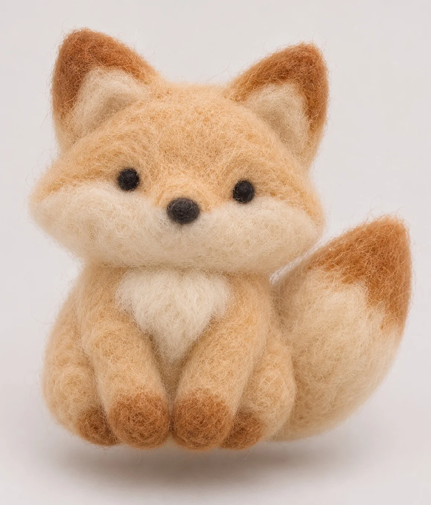

# Needle-Felted Wool Charm (Little Fox)

**中文标题：** 针毡羊毛小挂件（小狐狸）  
**ID:** `gi25-x-1463` · **Mode:** `generate`  
**Categories:** `general`  
**Tags:** `x-twitter`, `community`, `gpt-image-2.5`, `x-direct`, `zh`



### Needle-Felted Wool Charm (Little Fox)

```text
Create an image with the following visual system. Replace the subject as specified.

Visual system (light, color, composition, medium, mood):
一张约 1:1 到 4:5 的针毡羊毛软雕塑特写：一只可整体替换的手作针毡物件居中悬挂或微微悬空，背后是无缝纯平浅灰白背景。机位正面平视略抬一点，主体占画面约六到七成，边缘留干净负空间；浅景深，焦点落在绒毛纤维与形体转折处，背景彻底虚成均匀底色。柔和均匀漫射光从前上方进入，色温中性偏暖，形体下缘与下巴位有极浅软接触阴影，不要硬闪光与镜面高光。材质必须是针毡羊毛：表面有细短飞毛、毡结颗粒与手工压实痕迹，哑光不反光，圆润体积感，拒绝光滑塑料、树脂或超干净 CGI。配色以奶白/米白羊毛为主体底，可加一两处高饱和点缀色与深色块面，但整体仍是软雕塑实物感。画面没有任何文字、品牌、商标、水印或可读字母。安静、可摸、像手作展台随手拍的针毡挂件。

New subject:
针毡狐狸：圆滚滚的小狐狸坐姿，奶白到浅驼的主毛色，耳尖与尾巴尖一点焦糖棕，黑鼻头与两粒小黑眼，胸前一小撮更白的绒。整体只有针毡羊毛，无配件无底座。画面中没有文字。
```

- **Recommended model:** `gpt-image-2.5-sunburst`
- **Settings:** _(defaults)_
- **Source:** [community](https://x.com/static_stare/status/2118925718390202500) — @static_stare
- **License note:** Original public X post; quoted with attribution — remix with attribution
- **Notes:** Collected directly from X; original post https://x.com/static_stare/status/2118925718390202500; post text names GPT Image 2.5; discovered via X search, prompt re-verified against the original X post via api.fxtwitter.com; verified=True; visual-system + replaceable-subject template; prompt for image 1 of 4 (the author shares the other three on request); preview is image 1
- **Preview:** `previews/gi25-x-1463.webp`
