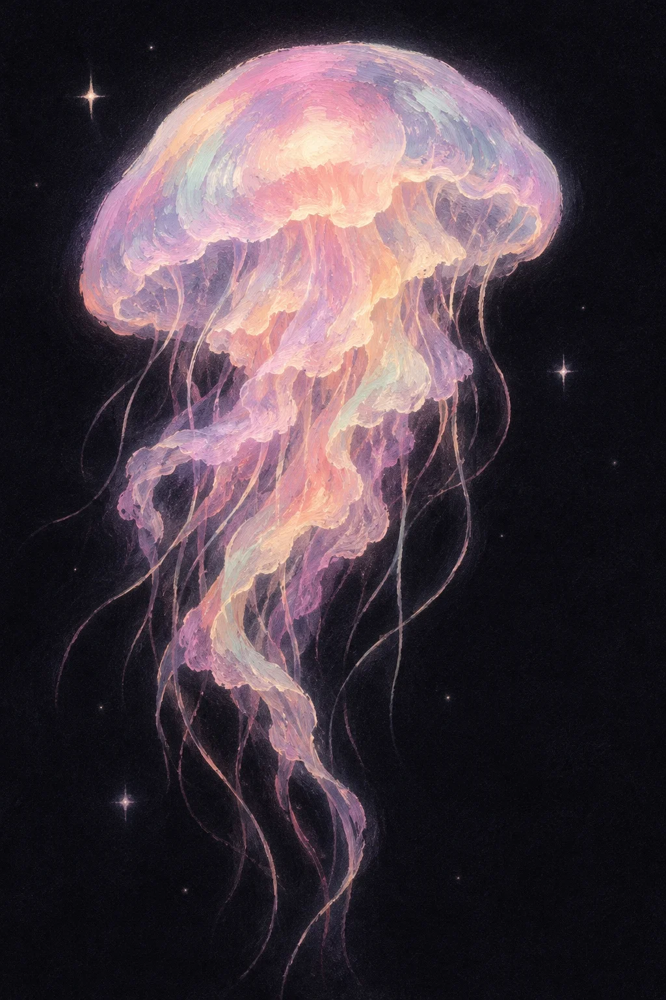

# Pastel Glowing Jellyfish in the Deep (Grain Illustration)

**中文标题：** 深海粉彩发光水母·颗粒插画  
**ID:** `gi25-x-1464` · **Mode:** `generate`  
**Categories:** `general`  
**Tags:** `x-twitter`, `community`, `gpt-image-2.5`, `x-direct`, `zh`



### Pastel Glowing Jellyfish in the Deep (Grain Illustration)

```text
Create an image with the following visual system. Replace the subject as specified.

Visual system (light, color, composition, medium, mood):
一幅竖幅约 9:16 到 3:4 的颗粒插画：近黑深海背景上，主体是一只（或一组）粉彩发光的半透明生物，厚笔触揉色，边缘有淡淡光晕。主体居中偏上，细须或触手拖尾向下，纵向引导视线；大块近黑负空间保留安静感。少量白色星芒闪点与细小光点散在黑底上，不要布满。光色体系是粉彩：蜜粉、薰衣草紫、浅薄荷、奶油黄与淡珊瑚在半透明体里互相渗开，暗底几乎不进蓝绿海水透视，也不走烛火梅紫或城市暖窗。笔触厚、可见，半透明叠色，不要光滑 3D 玻璃材质，不要照片级水下摄影。全画面细颗粒。安静深夜感，像深海里一点自己的光。画面没有任何文字。

New subject:
彩虹粉彩水母：一只水母居中偏上，伞盖圆润半透明，粉、薰衣草、薄荷与奶油黄揉在一起；伞下褶皱口腕，细须长长拖向画面下方；黑底上少量星芒闪点。画面中没有文字。
```

- **Recommended model:** `gpt-image-2.5-sunburst`
- **Settings:** _(defaults)_
- **Source:** [community](https://x.com/static_stare/status/2118709926067421398) — @static_stare
- **License note:** Original public X post; quoted with attribution — remix with attribution
- **Notes:** Collected directly from X; original post https://x.com/static_stare/status/2118709926067421398; post text names GPT Image 2.5; discovered via X search, prompt re-verified against the original X post via api.fxtwitter.com; verified=True; visual-system + replaceable-subject template; prompt for image 1 of 4 (the author shares the other three on request); preview is image 1
- **Preview:** `previews/gi25-x-1464.webp`
