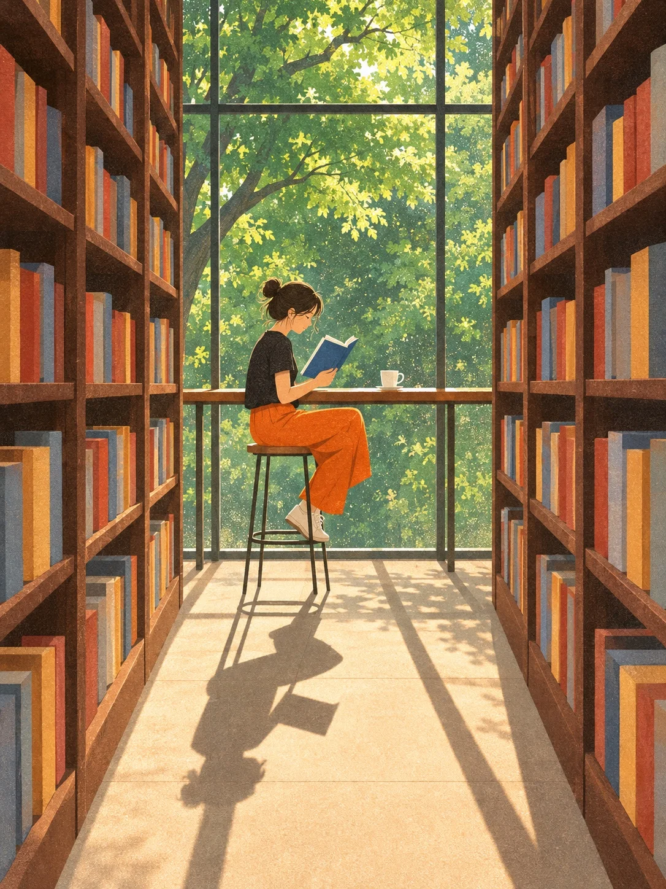

# Sunlit Library Aisle Flat Illustration

**中文标题：** 玻璃墙外的图书馆·平涂插画  
**ID:** `gi25-x-1465` · **Mode:** `generate`  
**Categories:** `general`  
**Tags:** `x-twitter`, `community`, `gpt-image-2.5`, `x-direct`, `zh`



### Sunlit Library Aisle Flat Illustration

```text
Create an image with the following visual system. Replace the subject as specified.

Visual system (light, color, composition, medium, mood):
一幅竖幅约 3:4 的平涂偏绘本插画：高书架夹出一条窄通道，尽头是落地玻璃墙，窗外是浓绿树冠；长长的阳光阴影落在浅色地板上。一点透视，机位约人眼高度看向通道尽头；左右书架高大、深褐木色，书脊只是色块条，没有任何可读文字。窗外树叶用块面与颗粒笔触表现，阳光从玻璃灌进来，室内相对更暗，人物与家具在地板上投下清晰偏长的暗影。全画面有细密纸面颗粒/噪点，颜色偏哑光，不要厚重油画笔触，也不要照片写实。配色：深褐书架、窗外翠绿、浅地板、书脊上的砖红/赭黄/灰蓝小色块；人物衣着可有一块亮色（如橙裤）做点缀。画面没有任何文字、字母或数字。安静、被阳光填满的图书馆午后。

New subject:
窗边读蓝色封面书的人：通道尽头玻璃墙前，一个人坐在细高脚凳边的窄桌前读一本蓝色封面的书，穿黑短袖与亮橙色长裤，桌上有一只小白杯；人与凳的长影投向近处地板。书脊只有色块无字。画面中没有文字。
```

- **Recommended model:** `gpt-image-2.5-sunburst`
- **Settings:** _(defaults)_
- **Source:** [community](https://x.com/static_stare/status/2118678175609954314) — @static_stare
- **License note:** Original public X post; quoted with attribution — remix with attribution
- **Notes:** Collected directly from X; original post https://x.com/static_stare/status/2118678175609954314; post text names GPT Image 2.5; discovered via X search, prompt re-verified against the original X post via api.fxtwitter.com; verified=True; visual-system + replaceable-subject template; prompt for image 1 of 4 (the author shares the other three on request); preview is image 1
- **Preview:** `previews/gi25-x-1465.webp`
