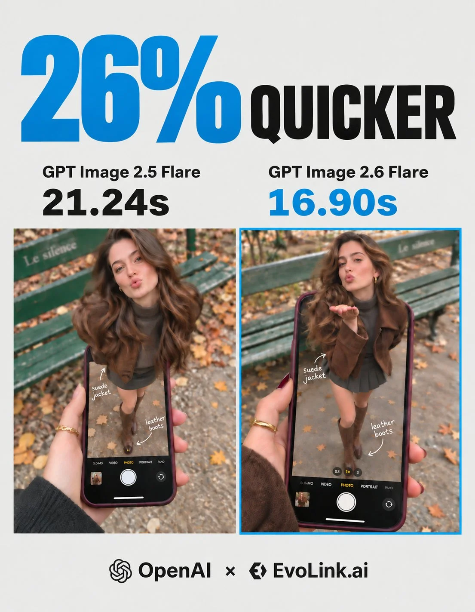

# Stepping Out of the Phone Screen Optical Illusion (JSON, 3:4)

**中文标题：** 从手机屏幕走出来的视错觉（JSON·3:4）  
**ID:** `gi25-x-1466` · **Mode:** `generate`  
**Categories:** `general`  
**Tags:** `x-twitter`, `community`, `gpt-image-2.5`, `x-direct`, `en`



### Stepping Out of the Phone Screen Optical Illusion (JSON, 3:4)

```text
{
"subject": {
"description": "A hyper-realistic optical illusion photograph. A young Caucasian woman appears to be stepping out of a smartphone screen held in a hand. The screen displays the camera interface, capturing her boots, while her real upper body extends out of the phone into reality.",
"mirror_rules": "Ensure the phone screen clearly shows the iOS Camera UI (shutter button, mode text). Handwritten annotations must be legible and not mirrored.",
"age": "20s",
"expression": {
"eyes": {"look": "Alluring and playful", "energy": "Confident, direct", "direction": "Looking at the viewer"},
"mouth": {"position": "Blowing a kiss or pouting", "energy": "Chic and charming"},
"overall": "Lifelike, engaging interaction"
},
"face": {"preserve_original": "false", "makeup": "Natural glam, matte foundation, defined European features", "features": "High nose bridge, double eyelids, defined jawline"},
"hair": {"color": "Dark brown", "style": "Long, loose waves, voluminous", "effect": "Realistic shine, wind-blown effect"},
"body": {
"frame": "Petite but proportionally realistic", "waist": "Defined", "chest": "Covered by turtleneck",
"legs": "Visible INSIDE the phone screen interface wearing boots",
"skin": {"visible_areas": "Face, hands", "tone": "Fair Caucasian skin", "texture": "Ultra-realistic skin texture, visible pores, natural imperfections", "lighting_effect": "Soft daylight"}
},
"pose": {"position": "Torso and head emerging vertically from the phone, legs displayed on the screen", "base": "Dynamic standing pose", "overall": "充满活力的随机姿势，让人感觉生命力满满"},
"clothing": {
"top": {"effect": "精致的穿搭，High-quality textile photography"},
"bottom": {"type": "Mini Skirt and Leather Boots", "color": "Dark Grey (skirt), Brown (boots)", "details": "Boots visible on the screen beneath the UI elements"}
}
},
"accessories": {
"jewelry": "Gold rings on the photographer's hand (foreground)",
"device": "Smartphone with burgundy case. The screen is ACTIVE and DETAILED: it displays the IOS Camera App Interface (white circular shutter button at bottom, 'PHOTO' text).",
"prop": "On the phone screen: White handwritten-style text overlays with arrows pointing to the outfit elements (e.g., text 'suede jacket' with arrow, 'leather boots' with arrow)."
},
"photography": {
"camera_style": "DSLR photography, Macro lens for phone details", "angle": "POV, High angle looking down at hand",
"shot_type": "Composite photography", "aspect_ratio": "3:4", "texture": "Sharp screen pixels, fingerprint smudges on screen, realistic fabric texture",
"lighting": "Overcast soft natural light", "depth_of_field": "Background bench blurred (Bokeh), Phone screen UI and subject sharp"
},
"background": {
"setting": "Parisian Park in Autumn", "wall_color": "Green bench, grey ground",
"elements": ["Green park bench with text 'Le silence'", "Autumn leaves"],
"atmosphere": "Cinematic, realistic", "lighting": "Natural ambient light"
},
"the_vibe": {
"energy": "Sophisticated, viral social media content", "mood": "Fashion forward", "aesthetic": "OOTD breakdown, creative edit",
"authenticity": "Photorealistic texture, not CGI", "intimacy": "POV", "story": "Fashion styling breakdown", "caption_energy": "Styling brown suede & leather"
},
"constraints": {
"must_keep": ["Caucasian ethnicity", "Photorealistic skin", "Camera UI elements on screen (shutter button)", "Handwritten text annotations on screen", "Pop-out effect"],
"avoid": ["Transparent phone screen", "Blank screen", "3D render style", "Cartoon", "Plastic skin"]
},
"negative_prompt": ["transparent screen", "blank screen", "glass phone", "3d", "render", "cartoon", "anime", "plastic", "drawing", "illustration"]
}
```

- **Recommended model:** `gpt-image-2.5-flare`
- **Settings:** _(defaults)_
- **Source:** [community](https://x.com/EvoLinkAi/status/2118750261091152058) — @EvoLinkAi
- **License note:** Original public X post; quoted with attribution — remix with attribution
- **Notes:** Collected directly from X; prompt posted as the author's own reply https://x.com/EvoLinkAi/status/2118750261091152058 to https://x.com/EvoLinkAi/status/2118750259551813789, which carries the images; GPT Image 2.5 is named in the parent post; discovered via X search, prompt re-verified against the original X post via api.fxtwitter.com; verified=True; cost comparison post (GPT Image 2.5 Flare vs 2.6 Flare); JSON prompt from the author's reply; GitHub link footer omitted; preview is the parent post image
- **Preview:** `previews/gi25-x-1466.webp`
