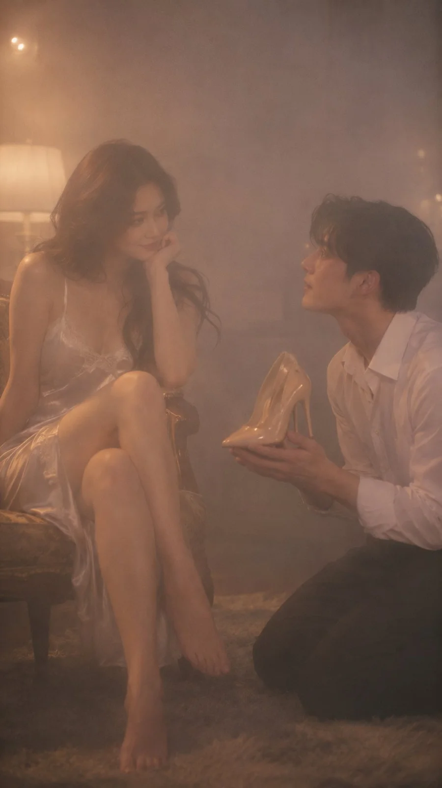

# 35mm Cinematic Armchair Two-Shot (9:16)

**中文标题：** 35mm 电影感扶手椅双人镜头（9:16）  
**ID:** `gi25-x-1469` · **Mode:** `generate`  
**Categories:** `general`  
**Tags:** `x-twitter`, `community`, `gpt-image-2.5`, `x-direct`, `en`



### 35mm Cinematic Armchair Two-Shot (9:16)

```text
A cinematic vertical 9:16 full-figure photograph captured on 35mm motion picture film — an elegant, intimate two-shot of an exceptionally gorgeous young East Asian woman seated gracefully in an armchair and a strikingly handsome young East Asian man kneeling before her on a plush wool rug.

The woman has top-tier celebrity-level beauty, a delicate symmetrical oval face, soft almond-shaped eyes, refined bone structure, and glossy dark chestnut waves falling over her shoulders. She sits with bare legs crossed, wearing a luxurious champagne-white silk slip dress with fine French lace trim, resting her chin on slender fingers with an alluring, gentle smile. The man possesses elite K-drama lead visuals, a clean sharp jawline, high straight nose bridge, and neat dark textured hair, dressed in a tailored crisp white cotton shirt and pressed black slacks. Kneeling with flushed cheeks, he reverently cradles a pair of nude patent leather stiletto pumps in both hands, gazing up at her in quiet admiration.

The scene is lit with real physical cinema gaffer lighting in a moody, upscale nighttime suite. A warm tungsten lamp provides a soft, directional key light that sculpts their facial features with realistic anatomical shadow falloff under the chin and jaw, reflecting gently on the silk fabric and hardwood floor.

Captured on a vintage 50mm cinema prime at f/2.0 with gentle highlight roll-off, authentic optical depth, and fine organic 35mm film grain in an M1 narrative register. Genuine human skin with ultra-fine pore texture, delicate peach fuzz along the jawline, and warm biological subsurface scattering — strictly no CGI, no 3D render, no plastic skin, no artificial beauty smoothing, no waxy AI look.
```

- **Recommended model:** `gpt-image-2.5-sunburst`
- **Settings:** _(defaults)_
- **Source:** [community](https://x.com/johnAGI168/status/2118015917892448744) — @johnAGI168
- **License note:** Original public X post; quoted with attribution — remix with attribution
- **Notes:** Collected directly from X; original post https://x.com/johnAGI168/status/2118015917892448744; post text names GPT Image 2.5; discovered via Bin0754/gpt-image-gallery index, prompt re-verified against the original X post via api.fxtwitter.com; verified=True; posted as ChatGPT Images 2.5
- **Preview:** `previews/gi25-x-1469.webp`
