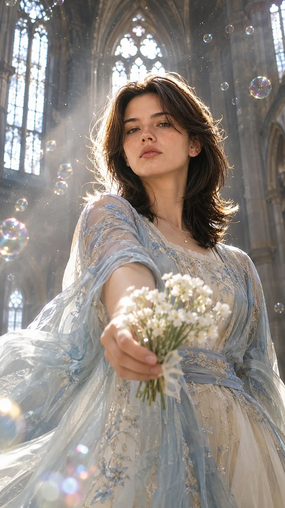

# Dreamy Gothic Cathedral Fashion Portrait (9:16)

**中文标题：** 梦幻哥特教堂时尚人像（9:16）  
**ID:** `gi25-x-1471` · **Mode:** `generate`  
**Categories:** `general`  
**Tags:** `x-twitter`, `community`, `gpt-image-2.5`, `x-direct`, `en`



### Dreamy Gothic Cathedral Fashion Portrait (9:16)

```text
Photorealistic vertical 9:16 dreamy fashion portrait inside a moody Gothic cathedral with tall arched windows. Low-angle shot from below, framed from the waist up. A woman reaches one hand toward the camera holding a small white flower bouquet. Bright backlight outlines her hair, with soft haze, floating bubbles, and sparkling dust in the air. Pale blue-and-ivory flowing outfit, ethereal cinematic mood, shallow depth of field, realistic skin, natural hands, no text, no logos, no watermark.
```

- **Recommended model:** `gpt-image-2.5-sunburst`
- **Settings:** _(defaults)_
- **Source:** [community](https://x.com/harboriis/status/2118670374779162779) — @harboriis
- **License note:** Original public X post; quoted with attribution — remix with attribution
- **Notes:** Collected directly from X; original post https://x.com/harboriis/status/2118670374779162779; post text names GPT Image 2.5; discovered via Bin0754/gpt-image-gallery index, prompt re-verified against the original X post via api.fxtwitter.com; verified=True
- **Preview:** `previews/gi25-x-1471.webp`
