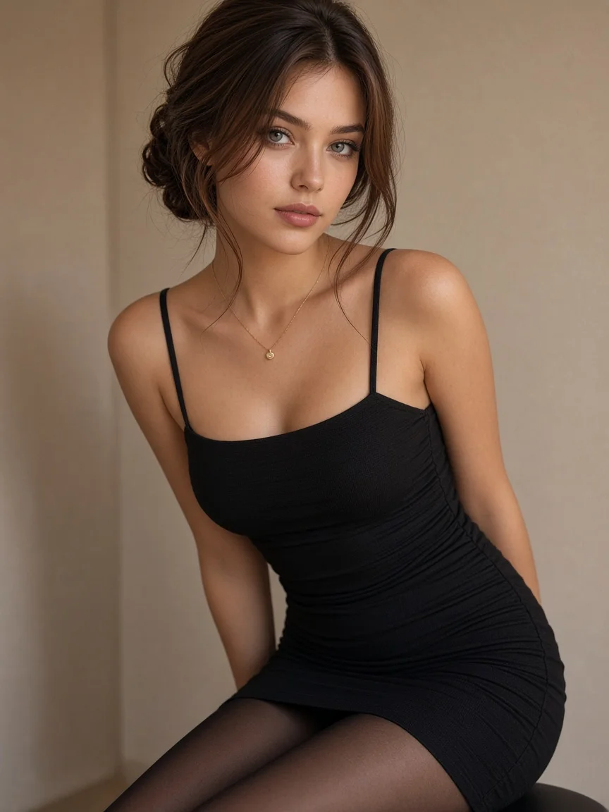

# Black Square-Neck Dress Half-Body Portrait (3:4)

**中文标题：** 黑色方领连衣裙半身人像（3:4）  
**ID:** `gi25-x-1476` · **Mode:** `generate`  
**Categories:** `general`  
**Tags:** `x-twitter`, `community`, `gpt-image-2.5`, `x-direct`, `en`



### Black Square-Neck Dress Half-Body Portrait (3:4)

```text
Create an ultra-realistic vertical 3:4 half-body fashion portrait of a beautiful young woman with a soft heart-shaped face, warm light skin, bright gray-green almond eyes, softly arched brows, and natural rose lips. She has long chestnut-brown hair in a loose low chignon with airy, side-parted curtain strands. She leans gently toward the camera indoors against a warm beige wall, with a subtle natural smile. She wears a tasteful fitted black spaghetti-strap mini dress with a higher square neckline, subtle side ruching, and smooth tailored fabric. Pair with sheer black tights and a delicate gold pendant necklace. Refined eyeliner, soft natural makeup, gentle warm indoor lighting, realistic skin texture, elegant feminine editorial photography, polished, sophisticated, high-end.
```

- **Recommended model:** `gpt-image-2.5-sunburst`
- **Settings:** _(defaults)_
- **Source:** [community](https://x.com/yaokict/status/2118616036614513128) — @yaokict
- **License note:** Original public X post; quoted with attribution — remix with attribution
- **Notes:** Collected directly from X; original post https://x.com/yaokict/status/2118616036614513128; post text names GPT Image 2.5; discovered via Bin0754/gpt-image-gallery index, prompt re-verified against the original X post via api.fxtwitter.com; verified=True; posted as GPT Image 2.5 on ChatGPT
- **Preview:** `previews/gi25-x-1476.webp`
