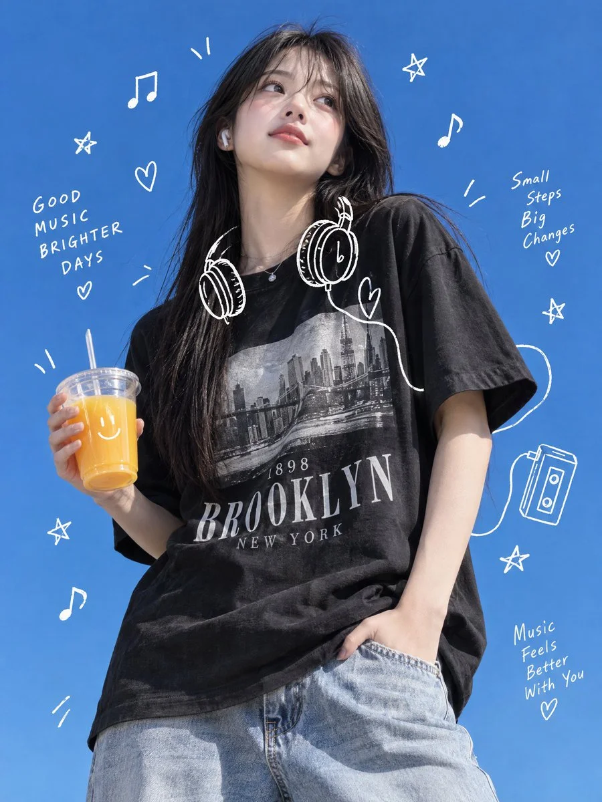

# Korean Streetwear Portrait with White Music Doodles (2:3)

**中文标题：** 韩系街头潮流人像+白色音乐涂鸦（2:3）  
**ID:** `gi25-x-1477` · **Mode:** `generate`  
**Categories:** `general`  
**Tags:** `x-twitter`, `community`, `gpt-image-2.5`, `x-direct`, `en`



### Korean Streetwear Portrait with White Music Doodles (2:3)

```text
Create an ultra-realistic, high-resolution Korean Gen-Z streetwear lifestyle photograph featuring a beautiful young East Asian woman standing casually against a completely clear, vibrant cobalt-blue sky. The overall aesthetic should resemble a premium Korean fashion magazine editorial mixed with playful, hand-drawn music-themed illustrations.

SUBJECT & APPEARANCE:
A young East Asian woman with naturally beautiful facial features, fair natural skin, soft pink lips, expressive dark brown eyes, and long, straight, glossy black hair with wispy curtain bangs falling loosely across her forehead. She has subtle natural makeup, a relaxed expression, and is looking slightly upward toward the left side of the frame. A small white wireless earbud is visible in her right ear. She wears a delicate silver necklace with a tiny pendant.

OUTFIT:
An oversized black vintage-style graphic T-shirt with loose sleeves and a relaxed silhouette. The front features a monochrome New York City skyline photograph with vintage typography reading "1898", "BROOKLYN" and "NEW YORK". Pair it with relaxed-fit, light-wash blue denim jeans with realistic fabric texture and natural folds. Effortless Korean streetwear styling.

POSE & PROPS:
The woman is standing in a relaxed, slightly diagonal pose, with her left hand casually tucked into the front pocket of her jeans. Her right hand holds a transparent disposable plastic cup filled with bright orange juice. The cup has a clear plastic lid and a cute white smiling-face illustration printed on its front. Her fingers naturally wrap around the cup. Her shoulders are relaxed, and her head is slightly tilted.

CREATIVE DOODLE OVERLAYS:
Surround the woman with delicate, playful white hand-drawn digital doodles, as if someone has sketched directly over the photograph using a fine white drawing pen. Include a large illustrated pair of over-ear headphones positioned around her neck and upper chest, floating musical notes, tiny five-pointed stars, small hearts, playful spirals, curved decorative strokes, and energetic motion lines around her hair, shoulders, arms, waist and body silhouette. Add a few white sketch outlines tracing parts of her figure. Include whimsical doodle swirls near the orange juice cup. All illustrations should have thin, slightly imperfect, organic white strokes, creating a spontaneous scrapbook-inspired aesthetic.

BACKGROUND & LIGHTING:
A completely clean, uninterrupted, vivid cobalt-blue summer sky with no buildings, trees or other objects. Bright natural sunlight illuminates her face, hair and arms, creating soft realistic shadows and subtle highlights. The transparent cup should have natural reflections. Maintain beautiful contrast between the blue background, black T-shirt, light-blue denim, orange drink and white doodles.

CAMERA & COMPOSITION:
Vertical 2:3 portrait composition, medium-full body framing from the head to the upper thighs. Slight low-angle camera perspective, subject positioned slightly right of center, generous negative space around her head for doodle illustrations. Professional fashion editorial photography, realistic skin texture, sharp facial details, accurate anatomy, natural hands, detailed clothing textures, balanced exposure, crisp focus and premium photographic quality.

FINAL ART DIRECTION:
The final image must look like a real photograph captured during a sunny summer fashion shoot, creatively enhanced with charming white music-inspired hand-drawn doodles. Keep the woman, her face, body, clothes, juice cup and background completely photorealistic. Only the decorative doodles should look illustrated. Youthful, refreshing, playful, aesthetic, effortlessly stylish and visually captivating.

NEGATIVE PROMPT: Anime, cartoon character, illustration-style face, CGI appearance, 3D render, plastic skin, excessive beauty filters, distorted face, asymmetrical eyes, unnatural hands, extra fingers, missing fingers, deformed anatomy, unrealistic body proportions, floating objects, malformed headphones, blurry details, harsh shadows, cluttered background, excessive doodles, thick sketch lines, random text, misspelled typography, unwanted logos, watermark, low resolution.

ASPECT RATIO: 2:3 | STYLE: Photorealistic Korean Streetwear Editorial | QUALITY: Ultra-High Definition
```

- **Recommended model:** `gpt-image-2.5-sunburst`
- **Settings:** _(defaults)_
- **Source:** [community](https://x.com/meng_dagg695/status/2120033832825155742) — @meng_dagg695
- **License note:** Original public X post; quoted with attribution — remix with attribution
- **Notes:** Collected directly from X; original post https://x.com/meng_dagg695/status/2120033832825155742; post text names GPT Image 2.5; discovered via X search, prompt re-verified against the original X post via api.fxtwitter.com; verified=True; made on ImagineArt with GPT Image 2.5 Sunburst; trailing 'Generate image' line omitted
- **Preview:** `previews/gi25-x-1477.webp`
