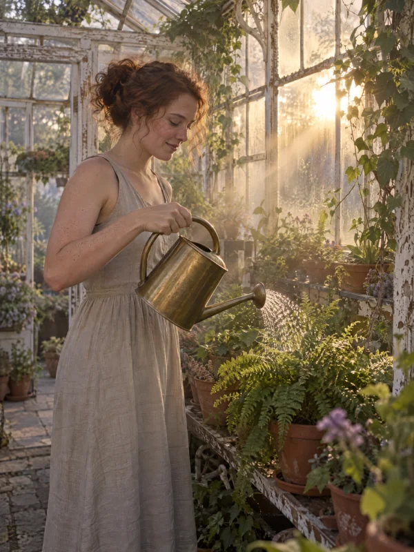

# Sunrise Greenhouse Watering Portrait (50mm)

**中文标题：** 日出温室浇花人像（50mm）  
**ID:** `gi25-x-1480` · **Mode:** `generate`  
**Categories:** `general`  
**Tags:** `x-twitter`, `community`, `gpt-image-2.5`, `x-direct`, `en`



### Sunrise Greenhouse Watering Portrait (50mm)

```text
Woman, late 20s, curly auburn hair tied back, oatmeal linen dress, watering ferns with a brass can in an old glass greenhouse at sunrise. Low sun through fogged glass, beams in light mist. 50mm, f/2. Sage, gold, lilac haze.
```

- **Recommended model:** `gpt-image-2.5-sunburst`
- **Settings:** _(defaults)_
- **Source:** [community](https://x.com/zencreator_io/status/2119890270514708902) — @zencreator_io
- **License note:** Original public X post; quoted with attribution — remix with attribution
- **Notes:** Collected directly from X; prompt posted as the author's own reply https://x.com/zencreator_io/status/2119890270514708902 to https://x.com/zencreator_io/status/2119890267272609814, which carries the images; GPT Image 2.5 is named in the parent post; discovered via Bin0754/gpt-image-gallery index, prompt re-verified against the original X post via api.fxtwitter.com; verified=True; comparison post (left Seedream 5 Pro, right GPT Image 2.5); prompt from the author's reply; preview is the right-hand GPT Image 2.5 image
- **Preview:** `previews/gi25-x-1480.webp`
