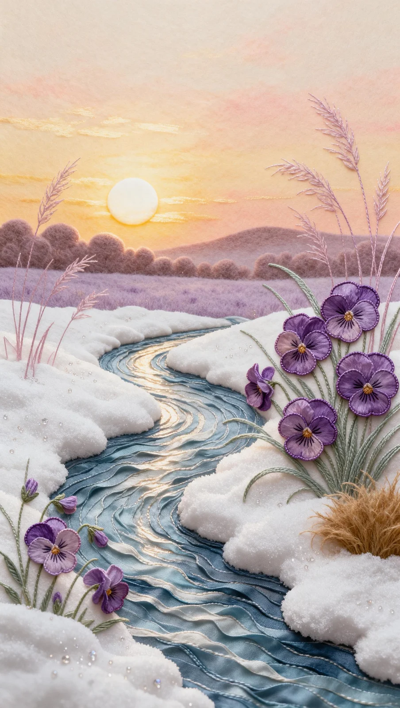

# Pastel Mixed-Media Relief Landscape with Pansies (16:9)

**中文标题：** 粉彩混合媒介浮雕风景·三色堇（16:9）  
**ID:** `gi25-x-1483` · **Mode:** `generate`  
**Categories:** `general`  
**Tags:** `x-twitter`, `community`, `gpt-image-2.5`, `x-direct`, `en`



### Pastel Mixed-Media Relief Landscape with Pansies (16:9)

```text
Handcrafted 3D mixed-media relief artwork photographed flat, wide 16:9 panoramic composition. Every surface is dimensional: fine sugar-grain foam clay, felted paste, tiny beads, pulled fibre and silk-ribbon applique, matte and tactile. Full bleed, no border, no lettering.
SKY: a smooth graded sunset from pale apricot and warm honey gold low on the horizon, deepening upward into soft rose, dusty peach and pale cream. A glowing white-gold sun disc rests just above the distant treeline at centre-left, ringed by a soft halo and thin horizontal light streaks.
DISTANCE: a low hazy silhouette of rolling hills and rounded tree crowns in muted mauve-brown, fading into warm mist, with a pale lavender meadow band behind the stream.
STREAM: a winding ribbon of water curves in a lazy S from the centre distance to the bottom edge, built from layered blue-teal and slate-blue silk-ribbon strips pressed into fine wavy ridges, each crest catching a soft cream highlight, pale gold light down its middle.
SNOW BANKS: sculpted drifts of pure white granular foam clay with a fine sugar texture border both sides of the stream, edges rounded and softly shadowed, rising into thick mounds at the right and lower left, peppered with tiny beads and crystal flecks.
FLOWERS RIGHT: a dense cluster of large purple pansies with layered ruffled petals in violet, lavender and amethyst, darker whisker markings and warm golden centres, appliqued from silk and edged with fine cord, among long slender green stitched grass blades arching outward.
FLOWERS LOWER LEFT: a smaller group of pansies and lavender buds with pale green stems rising from the white drift.
WHEAT: tall slender pinkish-lavender wheat stalks rise on both sides, ears built from hundreds of tiny stitched spikes, feathery and translucent, curving gracefully. A round golden tuft of dry grass sits in the lower right corner.
PALETTE: apricot, honey gold, rose peach, amethyst, lavender, sage green, slate blue, cream white. Raised tactile texture.
```

- **Recommended model:** `gpt-image-2.5-sunburst`
- **Settings:** _(defaults)_
- **Source:** [community](https://x.com/churvikv/status/2119707736690541007) — @churvikv
- **License note:** Original public X post; quoted with attribution — remix with attribution
- **Notes:** Collected directly from X; original post https://x.com/churvikv/status/2119707736690541007; post text names GPT Image 2.5; discovered via X search, prompt re-verified against the original X post via api.fxtwitter.com; verified=True; made on GMI Cloud; the post credits GPT Image 2.5 Sunburst and Seedream 5.0 Pro; preview is image 1
- **Preview:** `previews/gi25-x-1483.webp`
