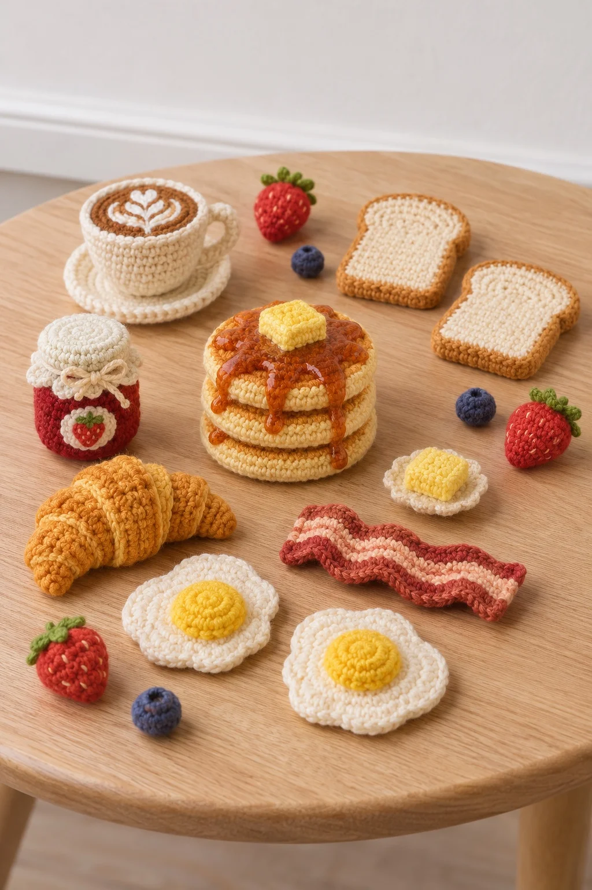

# Crochet Miniature Breakfast Table

**中文标题：** 钩针微缩早餐桌  
**ID:** `gi25-x-1485` · **Mode:** `generate`  
**Categories:** `general`  
**Tags:** `x-twitter`, `community`, `gpt-image-2.5`, `x-direct`, `zh`



### Crochet Miniature Breakfast Table

```text
Create an image with the following visual system. Replace the subject as specified.

Visual system (light, color, composition, medium, mood):
一张竖幅约 2:3 的钩针毛线微缩食物静物实拍：一张浅色橡木小桌占据画面中下大半，桌面上松散摆着十几件全部用毛线钩织的迷你食物和小物，大小从一颗葡萄到一片吐司不等，彼此互不重叠、留出桌面空隙，前排两三件大的，后排小件错落，像一张从近往远铺开的小餐桌。机位约 45 度斜俯拍，焦点落在画面中部，最远一排和桌腿轻微虚化；背景是一面素白墙和白色踢脚线，墙上没有任何装饰。光线是左侧窗户进来的柔和漫射日光，色温中性偏暖，每件毛线物在桌面投下柔和的短阴影，没有硬闪光。材质是清晰可见的短针钩织纹理：一圈圈螺旋针目、略起毛的棉线、填充后微微鼓起的圆润体积，叶子、奶油、切面这些细节用不同色线另钩再缝上去，看得出手工；不要塑料、黏土或 3D 渲染感。配色：浅木色和白墙打底，物件用饱和但柔和的番茄红、橘橙、柠檬黄、草绿、奶油白，颜色在桌面上分布均匀。画面无文字、无品牌、无水印。轻快、可爱，像手作博主中午把新钩好的一整套摆上桌拍了一张。

New subject:
钩针早餐桌：两个煎蛋、一叠三片淋了枫糖的松饼、两片吐司、一小罐草莓酱、一个牛角包、一杯带白色拉花的咖啡、一根培根、一小块黄油，旁边散着几颗草莓和蓝莓。全部是毛线钩织。画面中没有文字。
```

- **Recommended model:** `gpt-image-2.5-sunburst`
- **Settings:** _(defaults)_
- **Source:** [community](https://x.com/static_stare/status/2120015280411693325) — @static_stare
- **License note:** Original public X post; quoted with attribution — remix with attribution
- **Notes:** Collected directly from X; original post https://x.com/static_stare/status/2120015280411693325; post text names GPT Image 2.5; discovered via X search, prompt re-verified against the original X post via api.fxtwitter.com; verified=True; visual-system + replaceable-subject template; prompt for image 1 of 4 (the author shares the other three on request); preview is image 1
- **Preview:** `previews/gi25-x-1485.webp`
