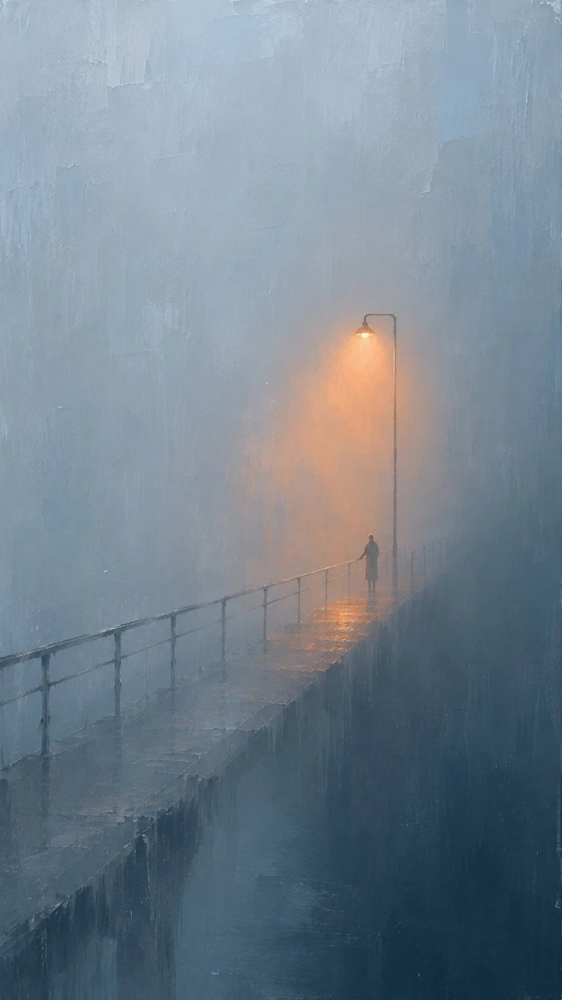

# One Orange Streetlamp in Blue Fog (Footbridge)

**中文标题：** 雾里一盏橙色街灯（人行桥）  
**ID:** `gi25-x-1486` · **Mode:** `generate`  
**Categories:** `general`  
**Tags:** `x-twitter`, `community`, `gpt-image-2.5`, `x-direct`, `zh`



### One Orange Streetlamp in Blue Fog (Footbridge)

```text
Create an image with the following visual system. Replace the subject as specified.

Visual system (light, color, composition, medium, mood):
一张竖幅约 9:16 的极简雾夜绘画：大面积灰蓝冷雾充满画面，上半部偏亮，是带一点白的雾蓝，画面一侧有一块更深的墨蓝暗面，像墙、山体或夜色，让亮雾和暗面形成竖向分界。画面里只有一盏灯，位置在中右偏上，发出橙黄暖光，光在雾里晕开成一团向下流淌的橙色光雾，一直落到地面，形成一小片暖色光斑，地面有薄薄的水光把这点橙色反射出来。画面下方中部可以有一个很小的人物剪影站在光下，高度约为画面的二十分之一，只是一个深色小轮廓。笔触是厚涂干刷与刮刀的纹理，带竖向拖痕、细颗粒和零星几点飞溅，像数字油画速写。构图大量留白，主体偏右，视线自上而下沿着光落到地面。配色：灰蓝与雾蓝约占七成，墨蓝暗面，橙金暖光是唯一的暖色。画面没有任何文字、签名或水印。克制、安静、孤独但不压抑，像深夜一个人路过时看到的那一盏灯。

New subject:
雾中人行桥：一座细栏杆的人行桥从画面左下斜伸进雾里，桥的另一头看不见；桥中段立着一根细灯柱，顶上那盏灯就是唯一的橙光；一个很小的人影站在灯下，手扶栏杆。暗面是桥下深色的河岸。画面中没有文字。
```

- **Recommended model:** `gpt-image-2.5-sunburst`
- **Settings:** _(defaults)_
- **Source:** [community](https://x.com/static_stare/status/2119794541960065124) — @static_stare
- **License note:** Original public X post; quoted with attribution — remix with attribution
- **Notes:** Collected directly from X; original post https://x.com/static_stare/status/2119794541960065124; post text names GPT Image 2.5; discovered via Bin0754/gpt-image-gallery index, prompt re-verified against the original X post via api.fxtwitter.com; verified=True; visual-system + replaceable-subject template; prompt for image 1 of 4 (the author shares the other three on request); preview is image 1
- **Preview:** `previews/gi25-x-1486.webp`
