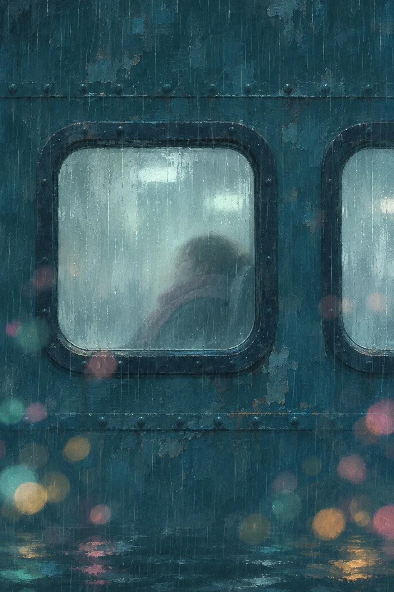

# Rainy Night Ferry Window, Soft-Focus Painting

**中文标题：** 雨夜渡轮舷窗·柔焦夜色绘画  
**ID:** `gi25-x-1487` · **Mode:** `generate`  
**Categories:** `general`  
**Tags:** `x-twitter`, `community`, `gpt-image-2.5`, `x-direct`, `zh`



### Rainy Night Ferry Window, Soft-Focus Painting

```text
Create an image with the following visual system. Replace the subject as specified.

Visual system (light, color, composition, medium, mood):
一张竖幅约 2:3 的雨夜数字绘画：从外侧正面平视，深青蓝色的外壁几乎占满整个画面，上面开着一到两扇圆角矩形窗，一扇居中偏左完整入画，另一扇被画面右边缘切掉一半。窗框是深墨蓝的粗边，窗玻璃被雨水和雾气打湿，里面泛着冷白到淡青的雾光，有细细的竖向雨痕往下流；窗内只看得见一个模糊的人物侧影或物件剪影，轮廓被水汽吃掉一半，看不清五官。窗外前景和外壁上漂浮着失焦的圆形光斑，青绿、粉红、琥珀黄三种颜色，大小不一，左下和右下更密，个别光斑压在窗框上。笔触是厚涂数字画笔，带干刷颗粒、斑驳噪点和细竖雨痕，外壁有不均匀的旧漆纹理。主光是窗内透出的冷白雾光，彩色光斑只做点缀，没有硬光源和清晰反光。配色：深青蓝外壁、冷白雾窗、零星粉、青、琥珀光点。画面没有任何文字、招牌字、签名或水印。安静、有点孤单，像一个人在雨夜回家的路上。

New subject:
末班渡轮船舱窗：外壁换成刷了深青漆的渡轮船舱钢板，带一排小铆钉，窗是圆角矩形舷窗；窗内是一个裹着围巾、靠着窗打盹的人的模糊侧影；窗外光斑来自远处码头灯和水面反光，下方隐约有一点水波。画面中没有文字。
```

- **Recommended model:** `gpt-image-2.5-sunburst`
- **Settings:** _(defaults)_
- **Source:** [community](https://x.com/static_stare/status/2119762940286894354) — @static_stare
- **License note:** Original public X post; quoted with attribution — remix with attribution
- **Notes:** Collected directly from X; original post https://x.com/static_stare/status/2119762940286894354; post text names GPT Image 2.5; discovered via Bin0754/gpt-image-gallery index, prompt re-verified against the original X post via api.fxtwitter.com; verified=True; visual-system + replaceable-subject template; prompt for image 1 of 4 (the author shares the other three on request); preview is image 1
- **Preview:** `previews/gi25-x-1487.webp`
