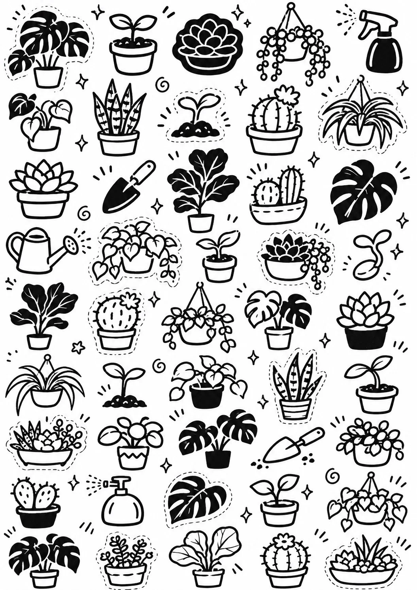

# Printable Black-and-White Doodle Sticker Sheet (Houseplants)

**中文标题：** 可打印黑白涂鸦贴纸页（室内绿植）  
**ID:** `gi25-x-1488` · **Mode:** `generate`  
**Categories:** `general`  
**Tags:** `x-twitter`, `community`, `gpt-image-2.5`, `x-direct`, `zh`



### Printable Black-and-White Doodle Sticker Sheet (Houseplants)

```text
Create an image with the following visual system. Replace the subject as specified.

Visual system (light, color, composition, medium, mood):
【画面风格】一张竖幅约 9:16（或 A4 竖幅）的可打印黑白涂鸦贴纸页：纯白底上密集排列约 40 到 50 枚独立小贴纸，大致按 5 列松散网格排布，大小有起伏，每枚之间留出清晰的白色间隙方便剪裁。全部只用黑白两色，三种画法混排：粗黑实心剪影、白底黑描线、黑底白线反白；约三分之一的贴纸外圈带一道白色或细虚线描边，模拟模切边。线条是粗细不均的手绘马克笔/墨笔感，造型圆润、略带俏皮，个别贴纸周围点缀小星星、小螺旋、小闪光符号。正面平视、平铺，像扫描件一样均匀平光，没有阴影、透视、纸张褶皱或桌面背景。同一张页面内所有贴纸属于同一主题，但姿态、角度、大小各不相同，避免重复。没有任何文字、字母、数字、品牌、Logo，也不出现任何现有卡通角色或游戏图标，全部为原创造型。完成态像在家用黑白打印机印出来的手作 zine 贴纸页，可直接剪下来贴手帐。

New subject:
【主体】室内绿植主题：龟背竹、虎尾兰、圆仙人掌、吊兰、多肉组合、琴叶榕、悬挂花盆、小喷壶、园艺铲、发芽的种子、一片单独的大叶子、陶盆里的小苗等，每种画 2 到 4 个不同姿态。画面中没有文字。
```

- **Recommended model:** `gpt-image-2.5-sunburst`
- **Settings:** _(defaults)_
- **Source:** [community](https://x.com/static_stare/status/2119727145446486440) — @static_stare
- **License note:** Original public X post; quoted with attribution — remix with attribution
- **Notes:** Collected directly from X; original post https://x.com/static_stare/status/2119727145446486440; post text names GPT Image 2.5; discovered via Bin0754/gpt-image-gallery index, prompt re-verified against the original X post via api.fxtwitter.com; verified=True; visual-system + replaceable-subject template; prompt for image 1 of 4 (the author shares the other three on request); preview is image 1
- **Preview:** `previews/gi25-x-1488.webp`
