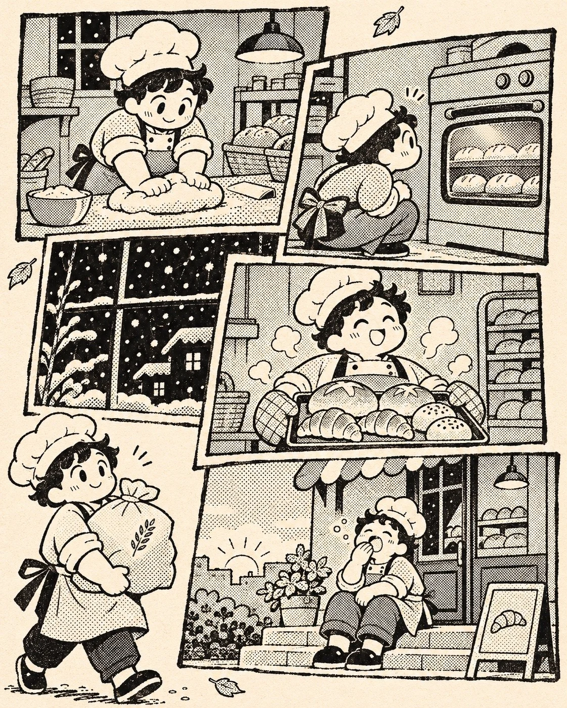

# Black-and-White Screentone Manga Page (Night Baker)

**中文标题：** 黑白网点漫画页（夜班面包师）  
**ID:** `gi25-x-1489` · **Mode:** `generate`  
**Categories:** `general`  
**Tags:** `x-twitter`, `community`, `gpt-image-2.5`, `x-direct`, `zh`



### Black-and-White Screentone Manga Page (Night Baker)

```text
Create an image with the following visual system. Replace the subject as specified.

Visual system (light, color, composition, medium, mood):
一张竖幅约 4:5 的黑白手绘漫画页：奶油米色纸底上，四到五个大小不一的方形分镜框轻微错位、互相压角叠放，用粗细略不均的黑墨手绘框线，从上到下讲同一位主角一天里的几个安静片段；其中一格让主角走出画框，直接站在纸面空白处，脚边有一小片手绘地面。线条是钢笔墨线，圆润、略抖、有手感，角色是大眼小嘴的卡通比例，表情简单可爱。所有中间调和阴影都用圆形网点（screentone）表现，深色块用实墨填黑；必须有一格做成黑底白点的反白夜景或落雪窗景，让整页有一块重色。格子之间的空白处散落几片手绘落叶或小物件作装饰。没有对白气泡、没有拟声字、没有签名、日期或任何可读文字。明暗只靠网点疏密和实墨面积区分，不做渲染光影。配色只有奶油纸色和纯黑墨，网点为黑。印刷感带一点墨色不均，像独立漫画小志里的一页。慢、暖、日常、带一点小幽默。

New subject:
夜班面包师：一个戴白色厨师帽、系围裙的圆脸面包师。几格分别是：深夜在案板上揉面、蹲在烤箱前盯着面包膨起、捧着一托盘刚出炉的面包、天快亮时坐在店门口台阶上打哈欠；走出画框那格是他抱着一大袋面粉。反白格是窗外深夜的小雪。画面中没有文字。
```

- **Recommended model:** `gpt-image-2.5-sunburst`
- **Settings:** _(defaults)_
- **Source:** [community](https://x.com/static_stare/status/2119696610925896061) — @static_stare
- **License note:** Original public X post; quoted with attribution — remix with attribution
- **Notes:** Collected directly from X; original post https://x.com/static_stare/status/2119696610925896061; post text names GPT Image 2.5; discovered via Bin0754/gpt-image-gallery index, prompt re-verified against the original X post via api.fxtwitter.com; verified=True; visual-system + replaceable-subject template; prompt for image 1 of 4 (the author shares the other three on request); preview is image 1
- **Preview:** `previews/gi25-x-1489.webp`
