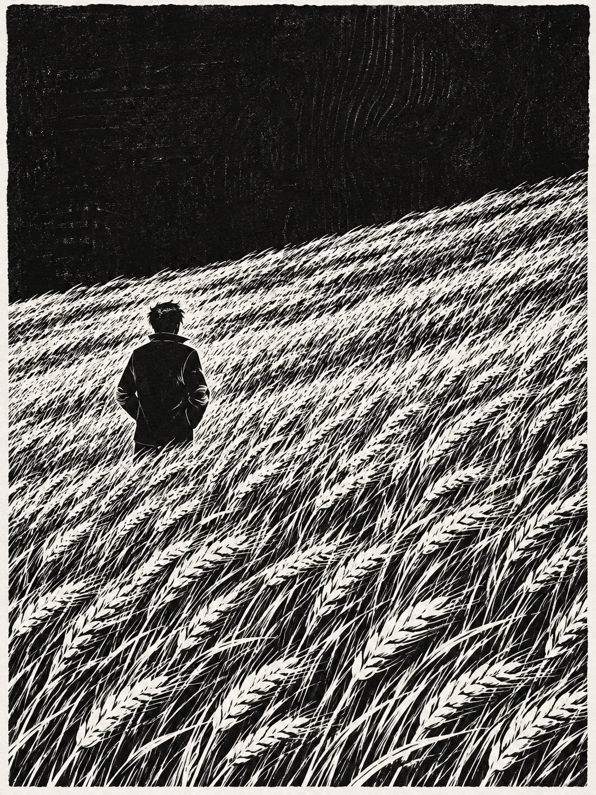

# Black-and-White Woodcut: Lone Figure in a Wheat Field

**中文标题：** 黑白木刻·麦田里的背影  
**ID:** `gi25-x-1490` · **Mode:** `generate`  
**Categories:** `general`  
**Tags:** `x-twitter`, `community`, `gpt-image-2.5`, `x-direct`, `zh`



### Black-and-White Woodcut: Lone Figure in a Wheat Field

```text
Create an image with the following visual system. Replace the subject as specified.

Visual system (light, color, composition, medium, mood):
一幅竖幅约 3:4 的黑白木刻/线刻版画，只有纸白与墨黑，没有灰色中间调。高对比：大面积墨黑天空或暗部，密密麻麻的白色刻痕表现草叶、雪坡或浪纹，刻痕短促、斜向、疏密有节奏，看得出刀痕与印压颗粒；纸面白底带轻微纤维，墨面可有极淡印版木纹。构图斜切：地平或草海边缘从左下往右上倾斜，人物以实心黑色孤影剪影出现，多半是背影或侧影，五官细节弱化，人物比例偏小。机位略高或平视中景，前景刻痕更密、远景略疏；人物在草叶/雪/浪之间显得小而稳，周围纹理把人物托住。不要数码平滑渐变，不要照片写实，不要彩色。画面没有任何文字、签名或数字。安静、孤寂，像一张手印的黑白版画。

New subject:
麦田里的背影：斜切的高密麦浪用白色短刻痕表现，墨黑天空占上三分之一；一个穿短外套的人背影站在麦田中，双手插兜，剪影实心黑色。画面中没有文字。
```

- **Recommended model:** `gpt-image-2.5-sunburst`
- **Settings:** _(defaults)_
- **Source:** [community](https://x.com/static_stare/status/2118639885670109457) — @static_stare
- **License note:** Original public X post; quoted with attribution — remix with attribution
- **Notes:** Collected directly from X; original post https://x.com/static_stare/status/2118639885670109457; post text names GPT Image 2.5; discovered via Bin0754/gpt-image-gallery index, prompt re-verified against the original X post via api.fxtwitter.com; verified=True; visual-system + replaceable-subject template; prompt for image 1 of 4 (the author shares the other three on request); preview is image 1
- **Preview:** `previews/gi25-x-1490.webp`
