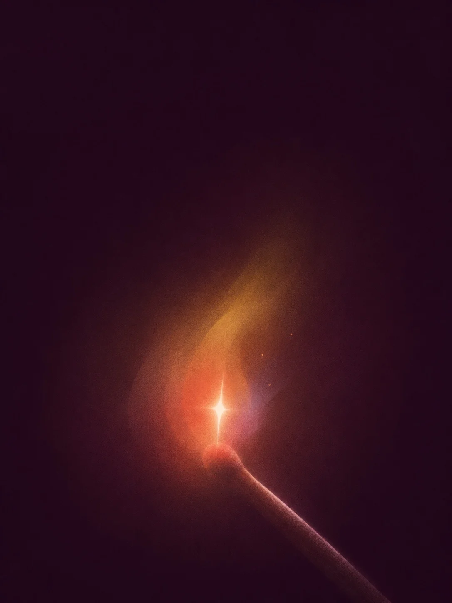

# Grainy Gradient Glow in the Dark (Struck Match)

**中文标题：** 黑暗里一点微光·颗粒渐变（火柴）  
**ID:** `gi25-x-1491` · **Mode:** `generate`  
**Categories:** `general`  
**Tags:** `x-twitter`, `community`, `gpt-image-2.5`, `x-direct`, `zh`



### Grainy Gradient Glow in the Dark (Struck Match)

```text
Create an image with the following visual system. Replace the subject as specified.

Visual system (light, color, composition, medium, mood):
一张竖幅 3:4 的极简数字插画，用细密颗粒的喷绘渐变来画光。画面里只有一个小小的发光点，近距离平视，位于画面中下部，顶部和两侧是大片接近黑色的暗梅紫背景，暗部偏紫褐炭黑，不要海军蓝或深蓝夜景，背景里没有任何场景。发光处是一个炽白的小核心，收成一颗四角尖细、纵向略长的星芒，不要放射状光束；围着它叠几片边缘柔化、互相穿透的半透明色团：外层蜂蜜黄和琥珀金向上微微偏斜，内层珊瑚橙红，交叠处藏一点雾蓝和淡紫，冷色只占很小一块。光从核心往外柔柔散开，越往外越暗，最后融进黑里，只照亮物体自身的一圈边缘，不照亮环境。承托发光点的小物件只画简化的几何轮廓，被画面底边或侧边裁切，表面只接住一道薄薄的粉白反光。所有渐变和色团都带细密随机噪点，像磨砂粉尘，轮廓若隐若现，没有硬边、塑料高光或第二个亮点。暗梅紫约占四分之三，暖黄和珊瑚红是主角，白色只在核心。没有文字。安静、亲密，像夜里一个人时的一点微光。

New subject:
一根刚划亮的火柴：细木火柴棍从画面右下方斜着伸进来，被底边裁切，火柴头上一小簇刚燃起的火苗是唯一亮处，火苗边缘飘着两三粒细小的火星，火柴棍顶端被照出一道粉白的光边。
```

- **Recommended model:** `gpt-image-2.5-sunburst`
- **Settings:** _(defaults)_
- **Source:** [community](https://x.com/static_stare/status/2118344979751796835) — @static_stare
- **License note:** Original public X post; quoted with attribution — remix with attribution
- **Notes:** Collected directly from X; original post https://x.com/static_stare/status/2118344979751796835; post text names GPT Image 2.5; discovered via Bin0754/gpt-image-gallery index, prompt re-verified against the original X post via api.fxtwitter.com; verified=True; visual-system + replaceable-subject template; prompt for image 1 of 4 (the author shares the other three on request); preview is image 1
- **Preview:** `previews/gi25-x-1491.webp`
