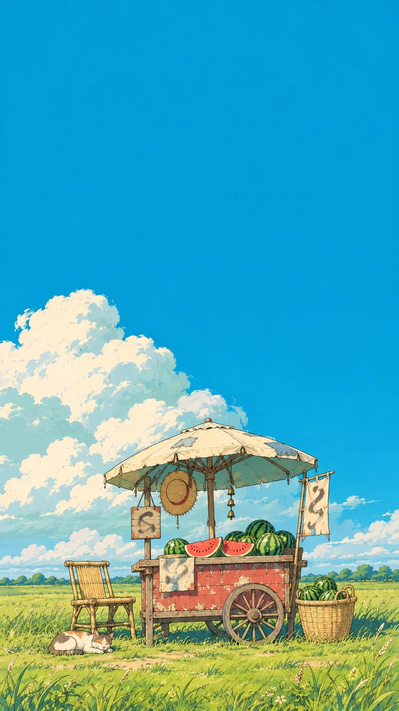

# Summer Meadow Roadside Stall Anime Background (Watermelon Cart)

**中文标题：** 夏日草地小摊·动画背景（西瓜车）  
**ID:** `gi25-x-1492` · **Mode:** `generate`  
**Categories:** `general`  
**Tags:** `x-twitter`, `community`, `gpt-image-2.5`, `x-direct`, `zh`



### Summer Meadow Roadside Stall Anime Background (Watermelon Cart)

```text
Create an image with the following visual system. Replace the subject as specified.

Visual system (light, color, composition, medium, mood):
一幅 9:16 竖幅的手绘动画背景插画，细墨线勾结构和磨损，平涂色块，云朵用不透明颜料层叠和断续干刷做出颗粒，没有摄影渐变、镜头光晕和厚重立体渲染。晴朗的夏日午后：高饱和青蓝天空占画面约六成，顶部是大片纯净的蓝；一团巨大的积云从左侧低处向中部隆起，云顶不超过画面中线，受光面奶油白，背光面浅青灰，有体积。地平线很低，底部横着一条黄绿色草地，前景草叶用细碎短线画出。主体是一处小小的路边生活设施，接近人眼高度的正面远景，完整入画，压在画面下部三分之一，尺寸不大，上方留出辽阔天空；主体有屋顶或顶篷、台面和挂着的小物三层，旁边有两三件生活道具自然围着。阳光从左上方照来，温暖明亮、边缘清楚，檐下阴影是透气的深蓝绿。颜色面积：青蓝天空最大，奶油白与浅青灰的云其次，黄绿草地铺底，褪朱红只集中在主体的一个主要立面上，麦秆米黄、旧木褐和炭灰用在框架和细线上。旧木板有褪色涂层、细裂纹和露底，布料有折痕。画面里没有人物，没有任何可读文字，布旗和小牌子上只有抽象墨迹。安静、悠闲，像一个没人看着的夏天下午。

New subject:
田埂边一辆卖西瓜的小木板车：褪朱红色的车厢板，上面撑一把旧帆布遮阳伞，车上堆着整只西瓜和切开的红瓤西瓜，伞骨上挂着一顶草帽和一串小铜铃；车旁一把竹椅、一只装西瓜的竹筐，草里躺着一只打盹的花猫。布旗或牌子上只有抽象墨迹，没有可读文字。
```

- **Recommended model:** `gpt-image-2.5-sunburst`
- **Settings:** _(defaults)_
- **Source:** [community](https://x.com/static_stare/status/2118315597108855199) — @static_stare
- **License note:** Original public X post; quoted with attribution — remix with attribution
- **Notes:** Collected directly from X; original post https://x.com/static_stare/status/2118315597108855199; post text names GPT Image 2.5; discovered via Bin0754/gpt-image-gallery index, prompt re-verified against the original X post via api.fxtwitter.com; verified=True; visual-system + replaceable-subject template; prompt for image 1 of 4 (the author shares the other three on request); preview is image 1
- **Preview:** `previews/gi25-x-1492.webp`
