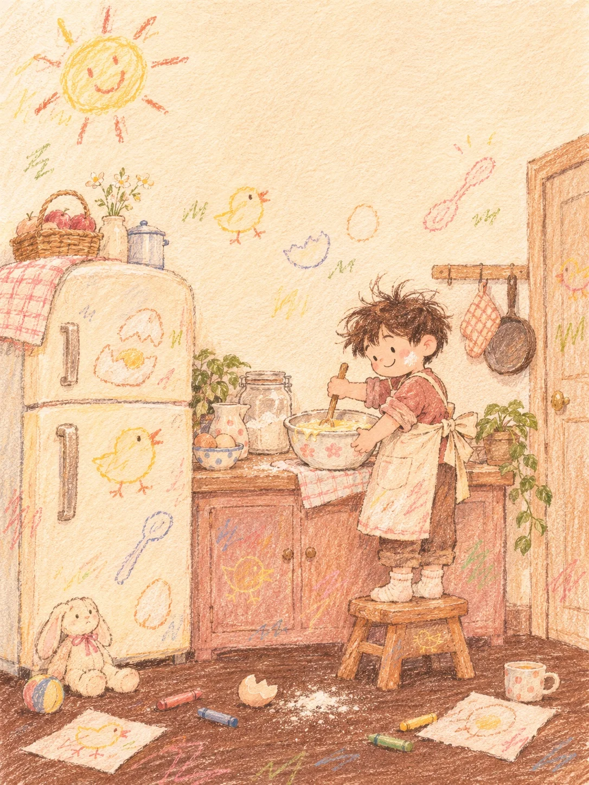

# Crayon Picture-Book Room with Doodled Walls (Kitchen)

**中文标题：** 墙上画满的小房间·蜡笔绘本（厨房）  
**ID:** `gi25-x-1494` · **Mode:** `generate`  
**Categories:** `general`  
**Tags:** `x-twitter`, `community`, `gpt-image-2.5`, `x-direct`, `zh`



### Crayon Picture-Book Room with Doodled Walls (Kitchen)

```text
Create an image with the following visual system. Replace the subject as specified.

Visual system (light, color, composition, medium, mood):
一幅竖幅约 3:4 的儿童绘本内页插画，用软蜡笔铺色、彩色铅笔叠线，画在暖奶油色的粗纹画纸上，纸纹透过所有色层，笔触干涩、断续，有轻微越界和反复涂抹，轮廓稚拙，透视带一点童趣，不要平滑上色和矢量轮廓。场景是一间有人在用、略微凌乱的室内角落。竖幅中远景，机位略高于人物视线，轻轻俯看，人物全身和脚边地面都入画；人物和家具集中在画面下半部，人物偏右，左侧一件大块的家具做视觉支点，上半部留出大片浅色墙面。墙上是孩子随手用蜡笔画的涂鸦：歪歪扭扭的小图形，疏密不均地散在留白里，有的涂鸦顺势画到了家具、门板和地板上，不要排成整齐的壁纸图案。前景地板上散落几支蜡笔、画纸和小物件。白天的柔和暖光从画外左上方进来，阴影浅而松散，没有强烈明暗。配色：暖奶油黄和浅麦色占一半，浅杏粉、灰玫瑰粉和赭木棕撑住家具和衣物，地板是深巧克力棕但看得出彩色笔迹，珊瑚红、柔钴蓝、草绿、明黄只以分散的小块出现在涂鸦和小物上。人物表情简单、放松。画面里没有任何文字、字母或数字，衣服上也没有字。温柔、自在，像一页讲平常日子的童书。

New subject:
早上的厨房一角：一个戴大围裙、头发翘起来的小男孩踩在小木凳上，站在矮橱柜前用木勺搅一大碗面糊，脸颊沾了一点面粉；左侧是一台圆角的旧冰箱，冰箱门和墙上有蜡笔画的鸡蛋、小鸡、勺子和一个笑脸太阳；地上散着蜡笔、一个空蛋壳和撒出来的一小撮面粉。画面中没有文字。
```

- **Recommended model:** `gpt-image-2.5-sunburst`
- **Settings:** _(defaults)_
- **Source:** [community](https://x.com/static_stare/status/2118246599998464056) — @static_stare
- **License note:** Original public X post; quoted with attribution — remix with attribution
- **Notes:** Collected directly from X; original post https://x.com/static_stare/status/2118246599998464056; post text names GPT Image 2.5; discovered via Bin0754/gpt-image-gallery index, prompt re-verified against the original X post via api.fxtwitter.com; verified=True; visual-system + replaceable-subject template; prompt for image 1 of 4 (the author shares the other three on request); preview is image 1
- **Preview:** `previews/gi25-x-1494.webp`
