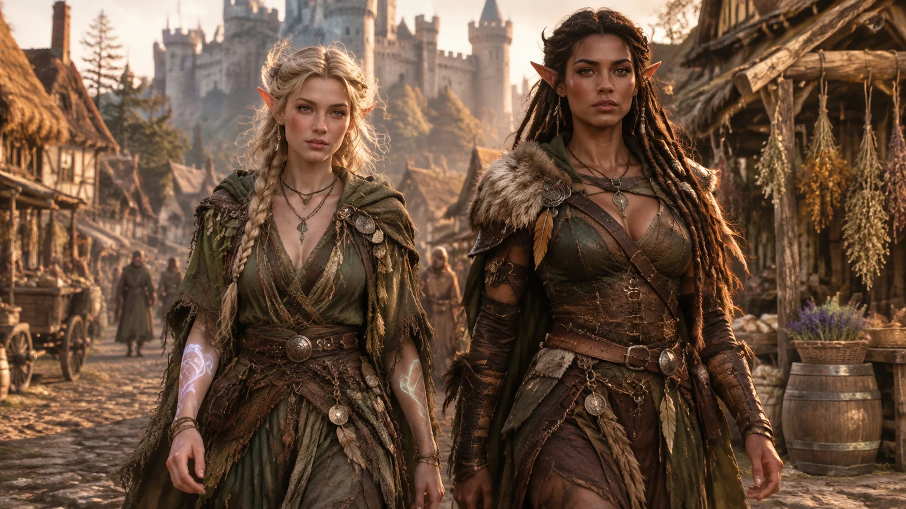

# Two Elven Adventurers in a Medieval Market Street (16:9)

**中文标题：** 中世纪集市街道上的两位精灵冒险者（16:9）  
**ID:** `gi25-x-1501` · **Mode:** `generate`  
**Categories:** `general`  
**Tags:** `x-twitter`, `community`, `gpt-image-2.5`, `x-direct`, `en`



### Two Elven Adventurers in a Medieval Market Street (16:9)

```text
Create a cinematic dark-fantasy medieval street scene in ultra-realistic 3D game concept art style, widescreen 16:9. In the foreground, show two adult elven adventurers walking side by side toward the viewer through a muddy cobblestone village road. The left character is a pale-skinned elf woman with long messy ash blonde braided hair, pointed ears, a delicate beautiful elven face with clear detailed features and soft expressive eyes, face fully visible with no covering, layered olive-green druid robes, leather belts, pouches, dangling metal charms, necklaces, torn fabric strips, leaf-and-feather details, and glowing white vine-like magical tattoos spiraling down both forearms. The right character is a darker-skinned elf woman with long thick dark brown dreadlocked hair, pointed ears, a strong handsome elven face with distinct features and a confident determined gaze, face fully visible with no covering, a green-and-brown leather ranger outfit, fur shoulder mantle, feather ornaments, arm wraps, belts, chains, talismans, and a confident warrior posture. Both faces are clearly and fully visible under natural light with sharp, detailed facial rendering; no censor blocks, no censor bars, no mosaic, no masks, and no object covering either face. Set the background in a richly detailed medieval market village with timber-and-thatch houses, hanging bundles of dried herbs on the right-side shopfront, barrels, baskets, wooden stalls, distant townspeople, and a large stone castle with towers and battlements rising in the background. Use warm late-afternoon golden sunlight, dramatic shadows, volumetric haze, shallow depth of field, realistic fabric and leather textures, high detail, moody fantasy atmosphere, cinematic composition, Unreal Engine quality, no text, no logos.
```

- **Recommended model:** `gpt-image-2.5-sunburst`
- **Settings:** _(defaults)_
- **Source:** [community](https://x.com/lnxinshng252654/status/2119047717829927167) — @lnxinshng252654
- **License note:** Original public X post; quoted with attribution — remix with attribution
- **Notes:** Collected directly from X; original post https://x.com/lnxinshng252654/status/2119047717829927167; post text names GPT Image 2.5; discovered via Bin0754/gpt-image-gallery index, prompt re-verified against the original X post via api.fxtwitter.com; verified=True; made on RunningHub; invite link and hashtags omitted
- **Preview:** `previews/gi25-x-1501.webp`
