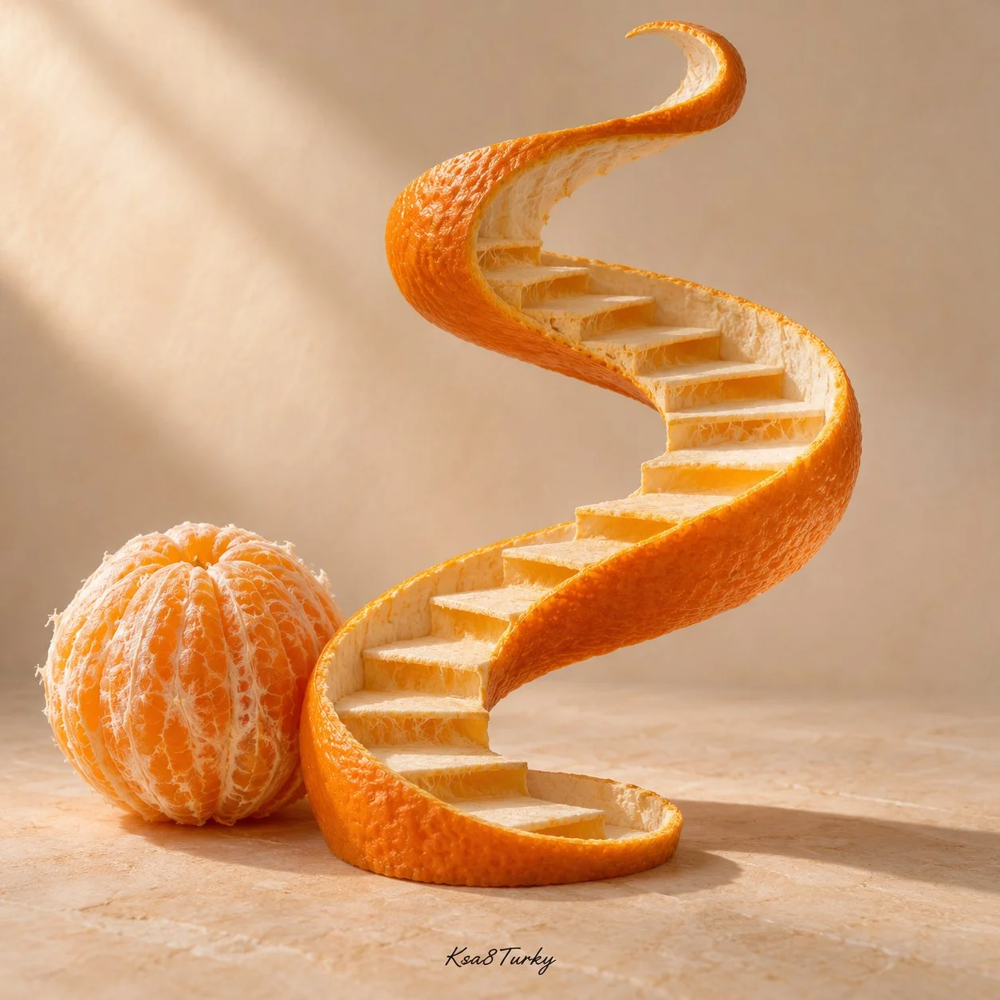

# Everyday Material Turned Architecture: Conceptual Studio Still (1:1)

**中文标题：** 日常材料变建筑：概念静物棚拍（1:1）  
**ID:** `gi25-x-1505` · **Mode:** `generate`  
**Categories:** `general`  
**Tags:** `x-twitter`, `community`, `gpt-image-2.5`, `x-direct`, `en`



### Everyday Material Turned Architecture: Conceptual Studio Still (1:1)

```text
Create a square conceptual studio photograph of [EVERYDAY MATERIAL] transformed into [ARCHITECTURAL FORM]. Example: an orange peel curls into a spiral staircase with readable folded treads, beside a peeled orange. Preserve recognizable material texture and coherent structure. Soft side light, ivory background, restrained palette, realistic sculptural shadows and negative space. Surreal artwork, not a real construction. No people, brands or headline. Small handwritten Ksa8Turky at bottom center.
```

- **Recommended model:** `gpt-image-2.5-sunburst`
- **Settings:** _(defaults)_
- **Source:** [community](https://x.com/ksa8Turky/status/2120309027641172308) — @ksa8Turky
- **License note:** Original public X post; quoted with attribution — remix with attribution
- **Notes:** Collected directly from X; original post https://x.com/ksa8Turky/status/2120309027641172308; post text names GPT Image 2.5; discovered via X search, prompt re-verified against the original X post via api.fxtwitter.com; verified=True; replaceable [EVERYDAY MATERIAL] / [ARCHITECTURAL FORM] template; the author's handwritten signature line is part of the original prompt
- **Preview:** `previews/gi25-x-1505.webp`
