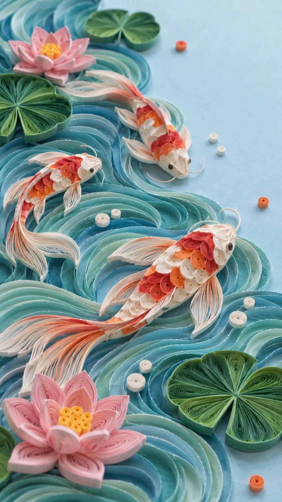

# Quilling Paper-Strip Relief: Koi Pond (9:16)

**中文标题：** 衍纸纸条卷浮雕：锦鲤池（9:16）  
**ID:** `gi25-x-1507` · **Mode:** `generate`  
**Categories:** `general`  
**Tags:** `x-twitter`, `community`, `gpt-image-2.5`, `x-direct`, `zh`



### Quilling Paper-Strip Relief: Koi Pond (9:16)

```text
Create an image with the following visual system. Replace the subject as specified.

Visual system (light, color, composition, medium, mood):
一张竖幅约 9:16 的衍纸艺术近距离实拍：整幅画面是一件用细长彩色纸条卷制、粘在一块淡天蓝色卡纸底板上的立体浮雕作品。大块面用侧立的纸条一条条顺着形状弯成密密的平行曲线，像等高线一样排出流动的方向感；亮部和边缘是一团团紧卷、松卷的螺旋纸卷，层层堆高，前后层次和纸的厚度都看得清。主体从画面一侧大幅铺开、占画面约三分之二，另一侧留出一块干净的浅色底板，只散落几个很小的点缀纸卷或小剪纸剪影。机位是略俯的近距离斜拍，贴着作品表面看过去，焦点在画面中部，最远处轻微虚化。光线是柔和的棚拍漫射光，从左上方来，色温中性略冷，每一圈纸卷的上沿都有细细的高光，下方有很小的柔和投影，能看见纸条的切边和胶点。配色：浅天蓝底板做大面积留白，主体用同一色系的三到四级深浅过渡，加奶白色螺旋纸卷做高光，再用一种对比色的小纸卷做点缀，颜色干净不脏。材质是哑光彩色卡纸，纸条宽度一致、边缘略有毛糙，一看就是手工卷的，不要塑料感、黏土感或 3D 渲染感。画面无文字、无签名、无水印。安静、精细，像手作艺术家把刚完成的作品放在工作室灯下拍的一张。

New subject:
锦鲤池：一片用青绿、湖蓝侧立纸条弯出的水波纹从画面下方和左侧铺开，水里游着三条橙红白相间的锦鲤，鱼身用紧卷纸卷拼出鳞片，鱼鳍和尾巴是松散飘开的细纸条；水面浮着几片深绿荷叶和两朵粉色睡莲，点缀几颗白色小纸卷水泡。不要海浪，不要日式浮世绘构图。画面中没有文字。
```

- **Recommended model:** `gpt-image-2.5-sunburst`
- **Settings:** _(defaults)_
- **Source:** [community](https://x.com/static_stare/status/2120376319804621187) — @static_stare
- **License note:** Original public X post; quoted with attribution — remix with attribution
- **Notes:** Collected directly from X; original post https://x.com/static_stare/status/2120376319804621187; post text names GPT Image 2.5; discovered via X search, prompt re-verified against the original X post via api.fxtwitter.com; verified=True; visual-system + replaceable-subject template; prompt for image 1 of 4 (the author shares the other three on request); preview is image 1
- **Preview:** `previews/gi25-x-1507.webp`
