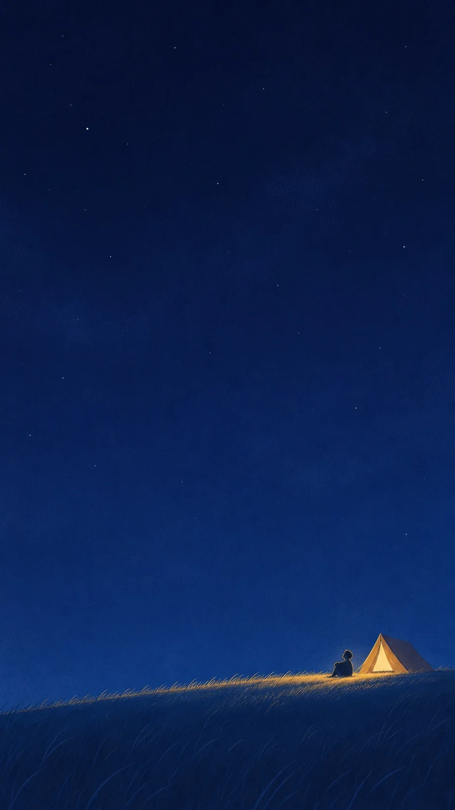

# Indigo Night Sky with One Warm Light: Tent on a Hill (9:16)

**中文标题：** 靛蓝星空下一点暖光：草坡帐篷（9:16）  
**ID:** `gi25-x-1508` · **Mode:** `generate`  
**Categories:** `general`  
**Tags:** `x-twitter`, `community`, `gpt-image-2.5`, `x-direct`, `zh`



### Indigo Night Sky with One Warm Light: Tent on a Hill (9:16)

```text
Create an image with the following visual system. Replace the subject as specified.

Visual system (light, color, composition, medium, mood):
一张竖幅约 9:16 的极简夜空插画：画面上方约四分之三是一整片深靛蓝夜空，从顶部近黑的藏青过渡到下方稍亮的钴蓝，天空里有极淡的云雾斑驳和细细的颗粒噪点，散着稀疏的白色小星点，大小不一，没有银河、流星和月亮。画面底部约四分之一是一道平缓的草坡、岸或水面，近处是暗蓝色的细长草叶笔触，坡顶有一条被暖光照成金黄色的草带。画面右下方只有一个很小的主体，宽度不超过画面宽度的四分之一，自带一处温暖的黄色灯光，旁边可以有一个更小的人影坐着或站着看天。光只来自主体那一点暖黄灯光，照亮附近的草或水，其余全是冷蓝的夜色。配色：靛蓝、藏青、钴蓝约占九成，暖金黄只出现在灯光和被照亮的那一小片上。媒介是扁平数字插画，加细颗粒纹理和丝网印刷般的噪点，轮廓干净、细节很少。大量留白，构图很空。画面无文字、无签名、无水印。安静、辽阔，一个人待着也不觉得孤单的深夜。

New subject:
草坡上的帐篷：坡顶一顶小三角帐篷，从里面透出暖黄灯光，门帘半开，帐篷外一个很小的人抱膝坐着抬头看天。画面中没有文字。
```

- **Recommended model:** `gpt-image-2.5-sunburst`
- **Settings:** _(defaults)_
- **Source:** [community](https://x.com/static_stare/status/2120156783994102038) — @static_stare
- **License note:** Original public X post; quoted with attribution — remix with attribution
- **Notes:** Collected directly from X; original post https://x.com/static_stare/status/2120156783994102038; post text names GPT Image 2.5; discovered via X search, prompt re-verified against the original X post via api.fxtwitter.com; verified=True; visual-system + replaceable-subject template; prompt for image 1 of 4 (the author shares the other three on request); preview is image 1
- **Preview:** `previews/gi25-x-1508.webp`
