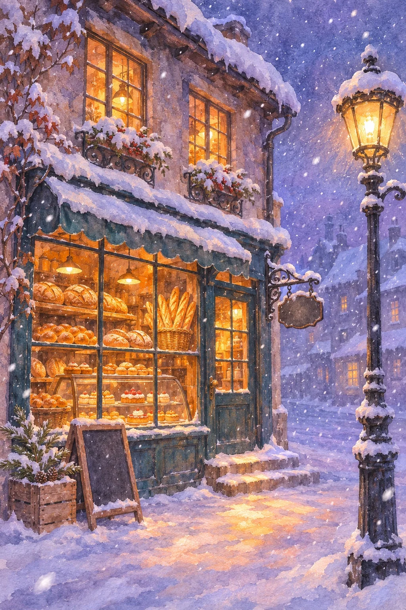

# Snowy-Night Corner Shop Watercolor: Bakery (2:3)

**中文标题：** 雪夜街角小店水彩暖光：面包店（2:3）  
**ID:** `gi25-x-1509` · **Mode:** `generate`  
**Categories:** `general`  
**Tags:** `x-twitter`, `community`, `gpt-image-2.5`, `x-direct`, `zh`



### Snowy-Night Corner Shop Watercolor: Bakery (2:3)

```text
Create an image with the following visual system. Replace the subject as specified.

Visual system (light, color, composition, medium, mood):
一张竖幅约 2:3 的雪夜老街小店水彩插画：画面主体是一栋两层老房子的临街店面，占画面左侧和中间约三分之二，用略低的街面视角、轻微仰角的四分之三侧面看过去，一楼是深青蓝色木框的大橱窗和一扇玻璃门，门口两三级台阶堆着雪，二楼窗户也亮着灯，屋檐、窗台和铁艺装饰上积着厚厚的白雪。右侧前景立一根黑色铸铁老式路灯，灯罩发出暖黄的光，背景是在落雪里渐渐隐去的蓝紫色屋顶。时间是天刚黑的黄昏，橱窗里透出浓郁的琥珀橙暖光，映在门前雪地上形成一片暖金色光斑，其余雪地、墙面阴影和天空是蓝紫、灰紫的冷色，冷暖对比很强。空中飘着大小不一的白色雪点，近处有几片较大。媒介是水彩加不透明水粉的笔触，边缘有湿画晕染、颜料颗粒和粗糙纸纹，细节松而不散。门边挂一块铸铁吊牌，但牌面空白，橱窗玻璃和门上都没有字。画面中没有任何可读文字、字母、品牌、签名或水印。安静、温暖，让人想推门进去的冬天傍晚。

New subject:
雪夜面包店：橱窗里是一层层木架，摆满圆面包、法棍、编织辫子面包，玻璃柜里有几盘小糕点，门口立一块空白的小黑板，旁边一只木箱里插着几根松枝。画面中没有文字。
```

- **Recommended model:** `gpt-image-2.5-sunburst`
- **Settings:** _(defaults)_
- **Source:** [community](https://x.com/static_stare/status/2120155780733338061) — @static_stare
- **License note:** Original public X post; quoted with attribution — remix with attribution
- **Notes:** Collected directly from X; original post https://x.com/static_stare/status/2120155780733338061; post text names GPT Image 2.5; discovered via X search, prompt re-verified against the original X post via api.fxtwitter.com; verified=True; visual-system + replaceable-subject template; prompt for image 1 of 4 (the author shares the other three on request); preview is image 1
- **Preview:** `previews/gi25-x-1509.webp`
