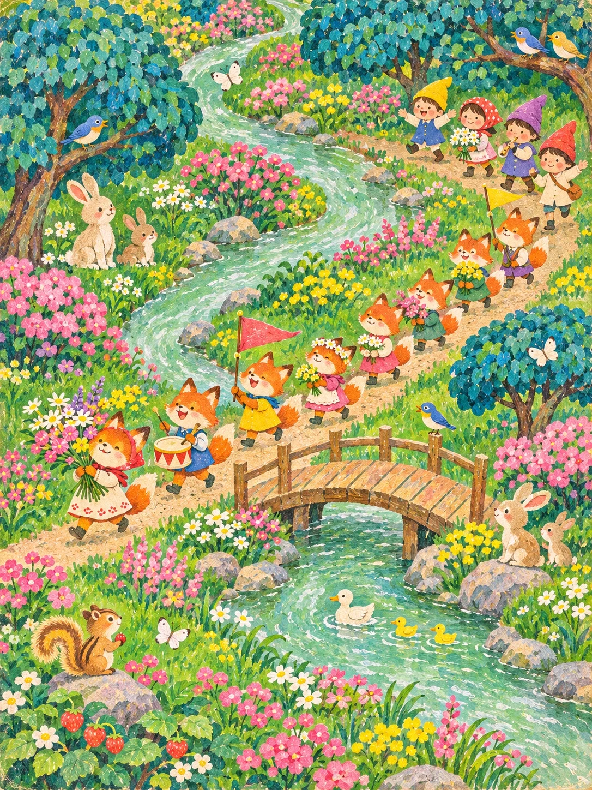

# Retro Gouache Picture-Book Page: Fox Wildflower Parade (3:4)

**中文标题：** 溪边复古水粉绘本页：狐狸野花游行（3:4）  
**ID:** `gi25-x-1511` · **Mode:** `generate`  
**Categories:** `general`  
**Tags:** `x-twitter`, `community`, `gpt-image-2.5`, `x-direct`, `zh`



### Retro Gouache Picture-Book Page: Fox Wildflower Parade (3:4)

```text
Create an image with the following visual system. Replace the subject as specified.

Visual system (light, color, composition, medium, mood):
一张竖幅约 3:4 的复古童书绘本插画，像六七十年代老绘本里的一整页水粉画：一条浅薄荷绿的小溪或小路从画面上方蜿蜒成 S 形穿过整页，两岸是满铺的草地、开花灌木和圆团状的树，画面里散布着十几个很小的故事角色和小动物，各自在做自己的事。人物都是圆脸、小点眼、尖帽或头巾，稚拙可爱，没有一个超过画面高度的十分之一。视角是略高的俯视平铺，像站在山坡上往下看，近大远小很弱，画面四边都被填满，几乎没有空白。时间是晴朗的白天，光线均匀平和，没有明显投影方向，靠颜色本身发亮。色彩是饱和的宝石调：草绿和翠绿铺底，青蓝、孔雀蓝的树冠，玫红、桃粉、柠檬黄的花点和衣服，白色雏菊和蝴蝶做跳色。画法要像上世纪中期的老绘本：大块平涂，形状简化，树是一团团扁平的色块，上面再用短笔触点出叶子，人物是简单的几何小人、细胳膊细腿，几乎没有明暗和立体感；不要现代日系可爱风，不要彩铅细描和精细阴影。青蓝、孔雀蓝的树冠要占到画面四分之一左右。材质是不透明水粉加丙烯的短笔触，花用小圆点和小星形，边缘略粗糙，带一点旧印刷纸的颗粒和轻微褪色。画面无文字、无签名、无水印。热闹、天真，像小时候翻到的那一页阳光很好的下午。

New subject:
狐狸野花游行：一队七八只小狐狸沿着溪边小路排队走，有的扛着一大束野花，有的举着没有字的小三角旗，有的敲小鼓，几个戴尖帽的小孩跟在队尾，路边有兔子和小鸟围观，溪上有一座小木桥。画面中没有文字。
```

- **Recommended model:** `gpt-image-2.5-sunburst`
- **Settings:** _(defaults)_
- **Source:** [community](https://x.com/static_stare/status/2120060962182922658) — @static_stare
- **License note:** Original public X post; quoted with attribution — remix with attribution
- **Notes:** Collected directly from X; original post https://x.com/static_stare/status/2120060962182922658; post text names GPT Image 2.5; discovered via X search, prompt re-verified against the original X post via api.fxtwitter.com; verified=True; visual-system + replaceable-subject template; prompt for image 1 of 4 (the author shares the other three on request); preview is image 1
- **Preview:** `previews/gi25-x-1511.webp`
