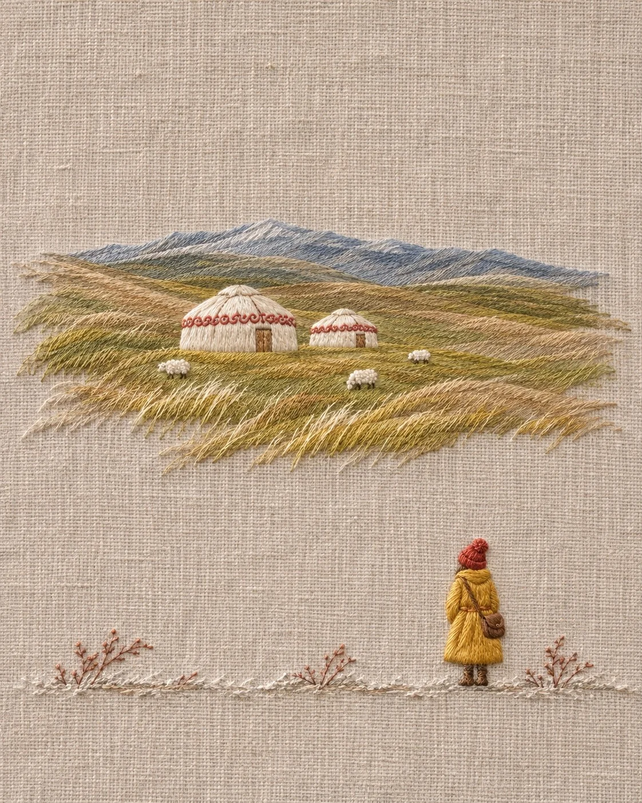

# Tiny Figure on Linen Embroidery: Autumn Steppe Yurts (4:5)

**中文标题：** 亚麻刺绣远方小背影：秋日草原毡房（4:5）  
**ID:** `gi25-x-1518` · **Mode:** `generate`  
**Categories:** `general`  
**Tags:** `x-twitter`, `community`, `gpt-image-2.5`, `x-direct`, `zh`



### Tiny Figure on Linen Embroidery: Autumn Steppe Yurts (4:5)

```text
Create an image with the following visual system. Replace the subject as specified.

Visual system (light, color, composition, medium, mood):
一张竖幅约 4:5 的手工刺绣作品正面平拍：整块画面是一块米灰色的细亚麻布，经纬纹理清楚可见，布面平整，大面积留白。画面中上部是一处用长短针一层层排线绣出的主景，针脚顺着形体的走向排列，边缘的线头自然散开、不刻意收齐，主景只占画面宽度的大半，上方和四周都是空布。右下方站着一个很小的人物背影，高度只有画面的五分之一左右，不要更大，用凸起的缎面绣做出饱满的立体感，穿芥末黄的长外套，戴一顶朱红色的毛线帽，身侧挎一个棕色小布包，面朝主景，看不到五官。画面最底部是一条窄窄的地面线，用白色和浅灰的短针绣出，上面点缀几小簇赭红色枯枝。光线是柔和均匀的室内自然光，从左上方来，绣线表面有细细的丝光，凸起处下方有很浅的阴影，能看出线的厚度。配色：米灰亚麻底占大半，主景用同一色系的三到四级深浅过渡加奶白高光，小人的芥末黄和朱红是全画面最亮的点缀。质感是真实的手工绣线和亚麻布纤维，线有轻微毛绒和捻纹，不要印刷感、水彩感或 3D 渲染感。画面无文字、无签名、无水印。安静、辽阔，一个人站在很大的风景前面。

New subject:
主景是一片缓缓起伏的秋天草原，用芥末绿、橄榄绿和浅褐的长针顺着坡势斜向排开，远处一道灰蓝色的山脊线，草原中间立着两座白色的圆顶毡房，顶上一圈朱红色花边，旁边散着几只用白色小结粒绣出的羊。小人站在右下方望着毡房。画面中没有文字。
```

- **Recommended model:** `gpt-image-2.5-sunburst`
- **Settings:** _(defaults)_
- **Source:** [community](https://x.com/static_stare/status/2120740038141247596) — @static_stare
- **License note:** Original public X post; quoted with attribution — remix with attribution
- **Notes:** Collected directly from X; original post https://x.com/static_stare/status/2120740038141247596; post text names GPT Image 2.5; discovered via X search, prompt re-verified against the original X post via api.fxtwitter.com; verified=True; visual-system + replaceable-subject template; prompt for image 1 of 4 (the author shares the other three on request); preview is image 1
- **Preview:** `previews/gi25-x-1518.webp`
