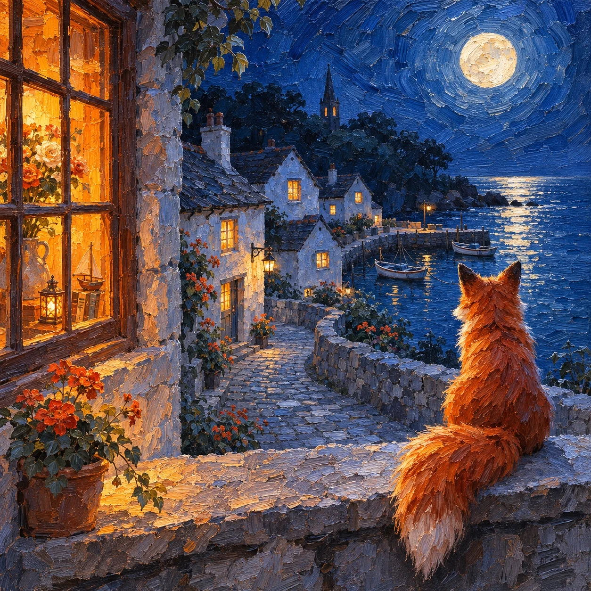

# Impasto Night Window: Fox Watching a Seaside Village (1:1)

**中文标题：** 厚涂油画窗台夜景：狐狸看海边渔村（1:1）  
**ID:** `gi25-x-1519` · **Mode:** `generate`  
**Categories:** `general`  
**Tags:** `x-twitter`, `community`, `gpt-image-2.5`, `x-direct`, `zh`



### Impasto Night Window: Fox Watching a Seaside Village (1:1)

```text
Create an image with the following visual system. Replace the subject as specified.

Visual system (light, color, composition, medium, mood):
一张方形 1:1 的厚涂油画夜景：前景是一处老房子的石砌窗台，一只动物背对观者坐在窗台上，安静地望向窗外月光下的小镇。画面左侧是一扇亮着灯的木格窗，窗格里透出浓郁的橙黄暖光，隐约看到屋里的花和小摆件；右侧是敞开的夜色，中景是一条弯曲的小路和几栋白墙尖顶的老房子，窗户都亮着暖黄小灯，屋后是深色的树丛和一座尖塔的剪影，天空挂一轮圆月。机位是从窗台后方略高处看出去，动物在右下前景，约占画面高度三分之一，轮廓清楚，毛色用颜料笔触一层层堆出来。光线有两种：冷蓝的月光从上方照下来，把墙面和路面染成灰蓝，室内的橙黄窗灯从侧面照亮窗台和动物一侧的毛边。配色：钴蓝、群青、灰蓝占大半，橙黄、琥珀暖光集中在亮着的窗户上，花丛里有几点橙红。媒介是厚涂油画，短促有力的笔触，能看到颜料堆起的厚度和画布纹理，天空和月亮周围是一圈圈旋转的笔触，墙面由碎笔触拼成。画面无文字、无签名、无水印。安静，有一点孤单，但很暖，像深夜睡不着的时候坐在窗边。

New subject:
一只红狐狸，蓬松的大尾巴垂在窗台边，窗外是一座海边小渔村，弯曲的石子坡道通向小港口，几条小木船泊在月光下的水面上，水里映着月亮。画面中没有文字。
```

- **Recommended model:** `gpt-image-2.5-sunburst`
- **Settings:** _(defaults)_
- **Source:** [community](https://x.com/static_stare/status/2120519261735317710) — @static_stare
- **License note:** Original public X post; quoted with attribution — remix with attribution
- **Notes:** Collected directly from X; original post https://x.com/static_stare/status/2120519261735317710; post text names GPT Image 2.5; discovered via X search, prompt re-verified against the original X post via api.fxtwitter.com; verified=True; visual-system + replaceable-subject template; prompt for image 1 of 4 (the author shares the other three on request); preview is image 1
- **Preview:** `previews/gi25-x-1519.webp`
