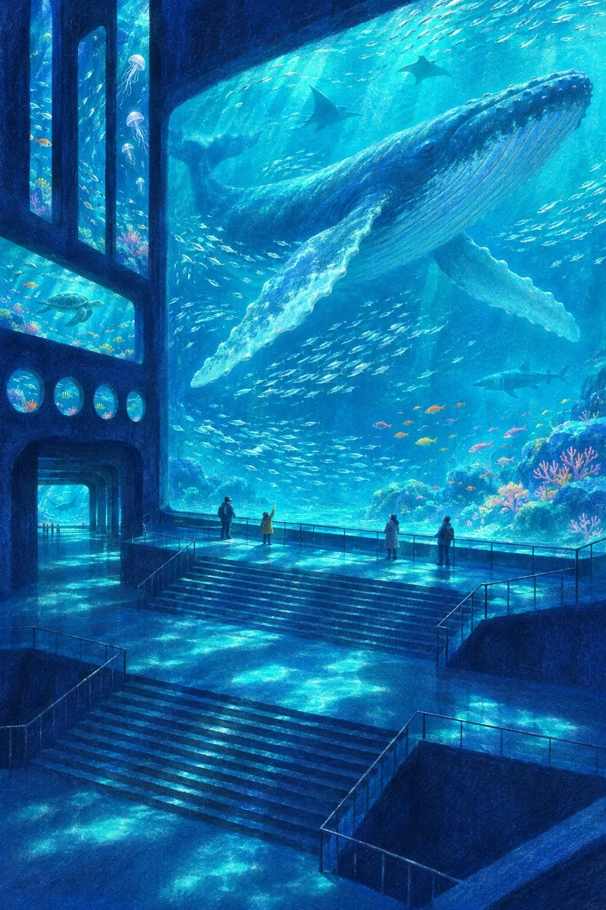

# Giant Aquarium Hall Grain Illustration: Whale Hall (2:3)

**中文标题：** 巨型水族馆颗粒插画：鲸鱼大厅（2:3）  
**ID:** `gi25-x-1520` · **Mode:** `generate`  
**Categories:** `general`  
**Tags:** `x-twitter`, `community`, `gpt-image-2.5`, `x-direct`, `zh`



### Giant Aquarium Hall Grain Illustration: Whale Hall (2:3)

```text
Create an image with the following visual system. Replace the subject as specified.

Visual system (light, color, composition, medium, mood):
一张竖幅约 2:3 的巨型水族馆大厅插画：一座高得看不到天花板的深蓝色室内大厅，墙上嵌着几面巨大的发光水族箱玻璃，有横向的方窗、顶天立地的竖长条窗和一排小圆舷窗，大小差别很大，最大的一面比人高出几十倍。玻璃里是明亮发光的青蓝色海水，游着鱼群和大型海洋生物，水箱透出的光是整个画面唯一的光源，在深蓝的地面、台阶和墙上投下一块块青蓝色的光斑。画面中下方是层层叠叠的台阶、平台和细栏杆，几个很小的参观者站在台阶上或贴着玻璃仰头看，每个人只有画面高度的二十分之一左右，用来衬出水箱和大厅的巨大。机位是略高的俯视斜角，像从二楼往下看，近处台阶和平台有清楚的几何块面，远处一条走廊通向另一面发光的水箱。配色：深靛蓝、普鲁士蓝的墙面和地面占大半，水箱是发光的青蓝、湖蓝，鱼群里点缀少量橙色、黄色和珊瑚粉的小鱼。媒介是数字手绘插画，带粗颗粒的粉彩蜡笔质感、柔和的模糊边缘，墙面铺满细密颗粒噪点。画面无文字、无签名、无水印。安静、有点神秘，像闭馆前一个人溜进了一座海底宫殿。

New subject:
鲸鱼大厅：大厅正面是一整面几乎占满画面上半的巨型玻璃，一头座头鲸张开长长的胸鳍从玻璃前游过，鲸身比整段台阶还长，周围一大群银色小鱼，台阶上三四个小小的参观者仰头看，其中一个小孩举着手。画面中没有文字。
```

- **Recommended model:** `gpt-image-2.5-sunburst`
- **Settings:** _(defaults)_
- **Source:** [community](https://x.com/static_stare/status/2120489166916255889) — @static_stare
- **License note:** Original public X post; quoted with attribution — remix with attribution
- **Notes:** Collected directly from X; original post https://x.com/static_stare/status/2120489166916255889; post text names GPT Image 2.5; discovered via X search, prompt re-verified against the original X post via api.fxtwitter.com; verified=True; visual-system + replaceable-subject template; prompt for image 1 of 4 (the author shares the other three on request); preview is image 1
- **Preview:** `previews/gi25-x-1520.webp`
