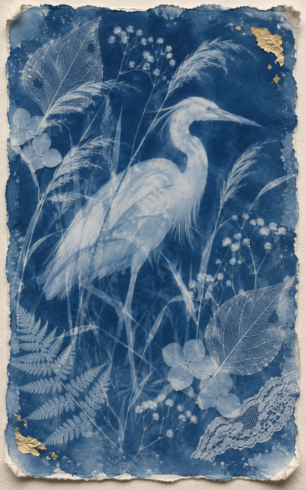

# Cyanotype with Gold Leaf: Egret in the Reeds (5:8)

**中文标题：** 蓝晒金箔印相：芦苇白鹭（5:8）  
**ID:** `gi25-x-1525` · **Mode:** `generate`  
**Categories:** `general`  
**Tags:** `x-twitter`, `community`, `gpt-image-2.5`, `x-direct`, `zh`



### Cyanotype with Gold Leaf: Egret in the Reeds (5:8)

```text
Create an image with the following visual system. Replace the subject as specified.

Visual system (light, color, composition, medium, mood):
【画面风格】一张竖幅约 5:8 的手工蓝晒印相，像贴在米白水彩纸上的一张完成品：纸的四周是不规则的毛边，略微翘起，纸面能看见细细的纤维。印相本身是深普鲁士蓝到靛蓝色的药液底，蓝得不均匀，边缘和边角有浅一些的药液水痕、细小的针孔和浅白斑点，不像电脑渐变。画面中部是一个发白、半透明的主体剪影，像被阳光漂白在纸上的形体，亮部接近纸白，暗部仍透出一层薄蓝，边缘有轻微的药液渗化。主体四周和轮廓上叠着同样用蓝晒做成的植物标本：叶脉清楚的枯叶、蕨叶、绣球花、满天星和一小片蕾丝，它们和主体交叠、半透明，像压在同一张药纸上一起曝光。纸边和主体轮廓附近散落几小片不规则的金箔，有的贴实、有的边缘翘起，金箔只是点缀，不要铺满。光线是均匀柔和的桌面自然光，从微微偏左上方来，能看出纸的厚度和毛边投下的很浅的阴影。配色：普鲁士蓝和靛蓝占绝大部分，主体和标本是白到浅蓝的曝光色，金箔是画面里唯一的暖色金属光。质感是真实的手工蓝晒和水彩纸，不要光滑的数字插画、不要油画、不要 3D 渲染。画面无文字、无签名、无水印、无品牌。安静、像从旧标本匣里抽出的一张晒图纸。

New subject:
【主体】主体是一只侧身站在芦苇丛里的白鹭，头转向画面右侧，长嘴和一条腿的轮廓清楚，身体是半透明的白影子。周围叠着蕨叶、叶脉枯叶和几枝细细的满天星，右上和左下各有一小片金箔。画面中没有文字。
```

- **Recommended model:** `gpt-image-2.5-sunburst`
- **Settings:** _(defaults)_
- **Source:** [community](https://x.com/static_stare/status/2121100202111389965) — @static_stare
- **License note:** Original public X post; quoted with attribution — remix with attribution
- **Notes:** Collected directly from X; original post https://x.com/static_stare/status/2121100202111389965; post text names GPT Image 2.5; discovered via X search, prompt re-verified against the original X post via api.fxtwitter.com; verified=True; visual-system + replaceable-subject template; prompt for image 1 of 4 (the author shares the other three on request); preview is image 1
- **Preview:** `previews/gi25-x-1525.webp`
