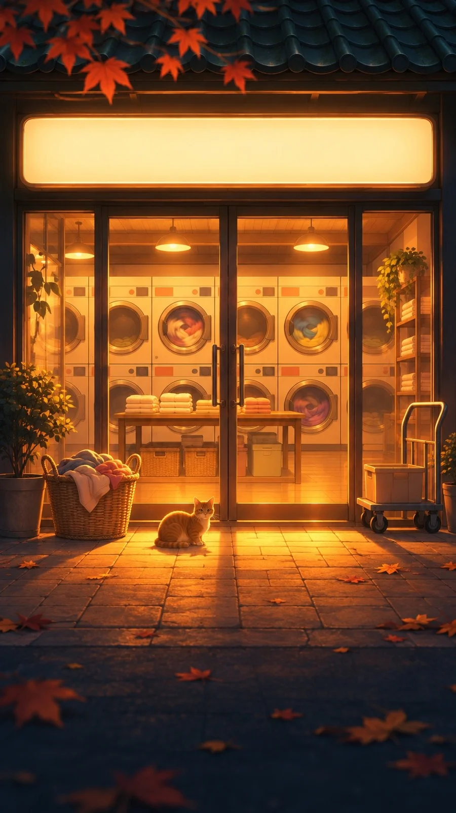

# Late-Night Shopfront Anime Glow: Laundromat (9:16)

**中文标题：** 深夜小店门口动画暖光：自助洗衣店（9:16）  
**ID:** `gi25-x-1526` · **Mode:** `generate`  
**Categories:** `general`  
**Tags:** `x-twitter`, `community`, `gpt-image-2.5`, `x-direct`, `zh`



### Late-Night Shopfront Anime Glow: Laundromat (9:16)

```text
Create an image with the following visual system. Replace the subject as specified.

Visual system (light, color, composition, medium, mood):
一张竖幅约 9:16 的动画电影感夜景：正面平视一间街边小店的门面，店门是两扇落地玻璃门，店里亮着很满的橙黄暖光，光从玻璃门和橱窗里溢出来，在门前的方砖人行道上铺开一大片发亮的光带，越往画面下方越暗。门上方是一块横向的店招灯箱，发着柔和的暖白光，但上面是空白的，没有任何字。门两侧堆着和这家店有关的东西，轮廓被背光勾出一圈金边。画面最上方是一截深青色的瓦片屋檐，几片橙红色的枫叶从屋檐边垂下来，稍微虚焦。地面散落着落叶，靠近光带的被照成金色剪影，远一点的沉进深蓝的阴影里。店外没有人。光线：唯一的光源是店里的暖光，色温很低，偏琥珀橙；店外是深海军蓝和靛青的夜色，冷暖对比强烈，亮处有轻微的光晕和柔和辉光。低机位平视，景深浅，前景落叶微微虚化。媒介是细致的 2D 动画背景加一点 3D 质感，像日本动画电影里的一帧，线条干净，光感柔和。店招、海报、包装、标签上都不要出现可读的文字、字母、数字、品牌或 Logo，只用色块和简单图形代替。安静、温暖，像深夜走在回家路上，整条街只有这一家还亮着。

New subject:
一家深夜自助洗衣店：玻璃门里是一整面墙的圆窗滚筒洗衣机，有几台里面正转着彩色的衣服，中间一张长木桌上放着叠好的毛巾，门口放着一只装满衣服的藤编洗衣篮和一辆小推车，一只橘猫蹲在门口的光带里。画面中没有文字。
```

- **Recommended model:** `gpt-image-2.5-sunburst`
- **Settings:** _(defaults)_
- **Source:** [community](https://x.com/static_stare/status/2120882758079951132) — @static_stare
- **License note:** Original public X post; quoted with attribution — remix with attribution
- **Notes:** Collected directly from X; original post https://x.com/static_stare/status/2120882758079951132; post text names GPT Image 2.5; discovered via X search, prompt re-verified against the original X post via api.fxtwitter.com; verified=True; visual-system + replaceable-subject template; prompt for image 1 of 4 (the author shares the other three on request); preview is image 1
- **Preview:** `previews/gi25-x-1526.webp`
