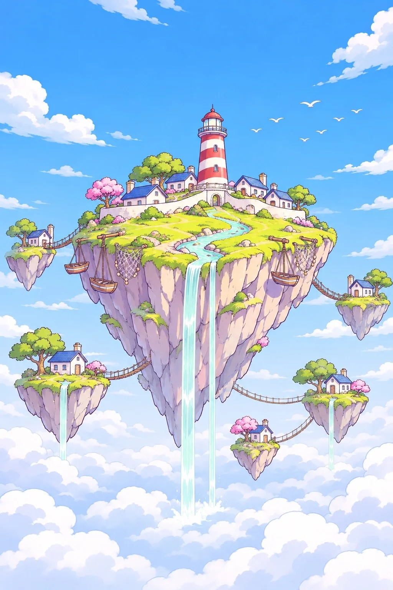

# Pastel Line-Art Floating Island: Lighthouse Village (2:3)

**中文标题：** 粉彩线描浮空岛：灯塔渔村（2:3）  
**ID:** `gi25-x-1527` · **Mode:** `generate`  
**Categories:** `general`  
**Tags:** `x-twitter`, `community`, `gpt-image-2.5`, `x-direct`, `zh`



### Pastel Line-Art Floating Island: Lighthouse Village (2:3)

```text
Create an image with the following visual system. Replace the subject as specified.

Visual system (light, color, composition, medium, mood):
一张竖幅约 2:3 的奇幻场景插画：一座很大的浮空岛悬在天空正中，岛的上半是起伏的草地和建筑，下半是一大块往下收尖的岩石，断面上是一道道竖向的岩纹。一条蓝绿色的小溪从岛顶的建筑群蜿蜒流下，冲出岛的边缘，变成一两道细长的瀑布直直落进下方的云海。主岛周围漂着四五座小一些的碎岛，各自带一点草皮、小树或小建筑，有的也垂着细瀑布。机位是略仰的远景，整座岛完整在画面里，上方和四周留出大片天空。光线是明亮的白天日光，从右上方照过来，阴影用淡紫色平涂，不压暗。配色：天空从顶部饱和的天蓝渐变到下方奶白的云海，草地是黄绿和苹果绿，岩石是奶油米黄配淡紫阴影，树冠和点缀用棉花糖粉，水是清透的薄荷蓝。媒介是干净的数字线描插画：统一粗细的深紫褐色描边，平涂加一两层柔和的赛璐璐阴影，云是大块柔边的白色和淡蓝，远处天上有一个淡淡的剪影飞过。画面无文字、无签名、无水印。轻快、明亮，像冒险游戏开场时第一次看到的那座岛。

New subject:
主岛顶上是一座红白条纹的灯塔和一圈白墙蓝顶的小渔屋，岛边挂着几只小木船和渔网，周围的碎岛上各有一间小屋，岛和岛之间用细细的绳索吊桥连着。远处天上飞过一群海鸥的剪影。画面中没有文字。
```

- **Recommended model:** `gpt-image-2.5-sunburst`
- **Settings:** _(defaults)_
- **Source:** [community](https://x.com/static_stare/status/2120851225143071147) — @static_stare
- **License note:** Original public X post; quoted with attribution — remix with attribution
- **Notes:** Collected directly from X; original post https://x.com/static_stare/status/2120851225143071147; post text names GPT Image 2.5; discovered via X search, prompt re-verified against the original X post via api.fxtwitter.com; verified=True; visual-system + replaceable-subject template; prompt for image 1 of 4 (the author shares the other three on request); preview is image 1
- **Preview:** `previews/gi25-x-1527.webp`
