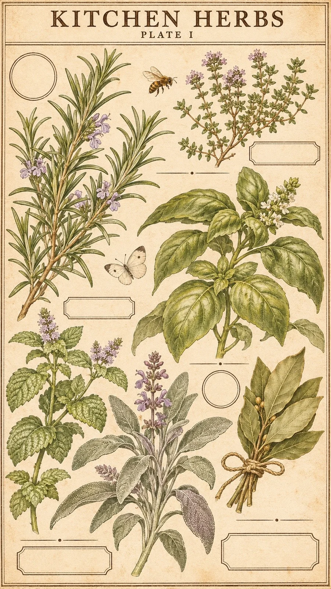

# Vintage Botanical Plate: KITCHEN HERBS (9:16)

**中文标题：** 复古植物图鉴图版：厨房香草（9:16）  
**ID:** `gi25-x-1528` · **Mode:** `generate`  
**Categories:** `general`, `poster-typography`  
**Tags:** `x-twitter`, `community`, `gpt-image-2.5`, `x-direct`, `zh`



### Vintage Botanical Plate: KITCHEN HERBS (9:16)

```text
Create an image with the following visual system. Replace the subject as specified.

Visual system (light, color, composition, medium, mood):
【画面风格】一张竖幅约 9:16 的复古植物图鉴拼贴图版，正面平拍、铺满画面：底是一张略泛黄的奶油色旧纸，带极淡的纸纤维和几处轻微污点。画面四周有一道细细的深棕色双线边框，上方留一块横向标题区，标题区上下各一条细线。图版里散排五到七株同一主题的植物或物件，全部用细腻的蚀刻线稿手绘，靠细密排线表现明暗，再用低饱和的水彩淡淡上色：橄榄绿、鼠尾草绿、赭橙、芥末黄、灰紫，颜色只上在形体里，留出纸白。主体大小错落，最大的一两株从底部一直伸到画面中上部，小的穿插在空隙里，中间散落两三只小昆虫做点缀，再配几个空白的小标签框、细线分隔条和小圆形图章框，这些框里都是空的，不写字。整张图版的文字只有两处：顶部标题区一行深棕色古典衬线大写标题，标题下面一行更小的副标，逐字照写、拼写准确；除此之外不添加任何其他文字、字母、数字、签名或 Logo。光线是均匀的平光，像扫描出来的印刷品，没有投影。质感是老式石版印刷加手工上色的博物学插图，线条清晰不糊。安静、耐看，可以直接拿去做海报、手账素材或手机壁纸。

New subject:
【主体】厨房香草图鉴。顶部标题："KITCHEN HERBS"；副标："PLATE I"。画面里是迷迭香、百里香、罗勒、薄荷、鼠尾草和一小捆用麻绳扎起来的月桂叶，点缀一只蜜蜂和一只白色小粉蝶。图版上只有这两处文字。
```

- **Recommended model:** `gpt-image-2.5-sunburst`
- **Settings:** _(defaults)_
- **Source:** [community](https://x.com/static_stare/status/2120815285544575429) — @static_stare
- **License note:** Original public X post; quoted with attribution — remix with attribution
- **Notes:** Collected directly from X; original post https://x.com/static_stare/status/2120815285544575429; post text names GPT Image 2.5; discovered via X search, prompt re-verified against the original X post via api.fxtwitter.com; verified=True; visual-system + replaceable-subject template; prompt for image 1 of 4 (the author shares the other three on request); preview is image 1
- **Preview:** `previews/gi25-x-1528.webp`
