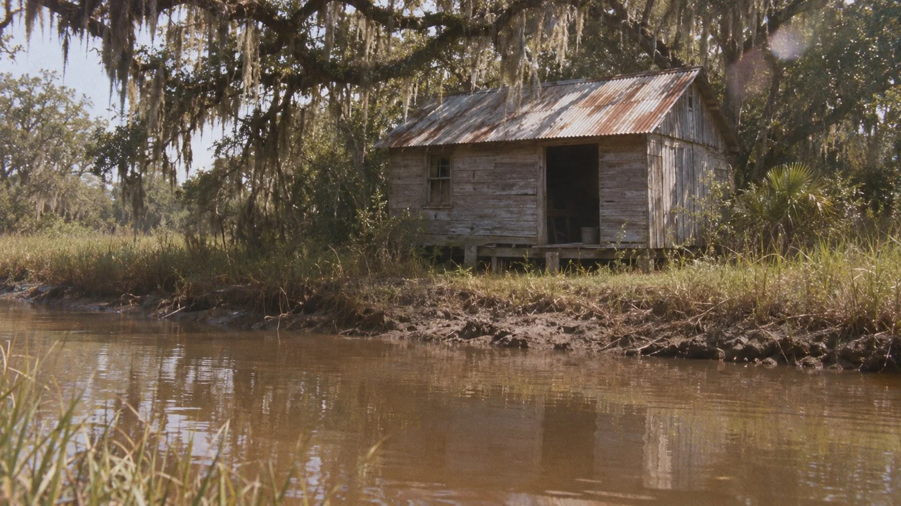

# 1970s 35mm Photochemical Film Still: Lowcountry Swamp Shack

**中文标题：** 1970 年代 35mm 胶片电影剧照：低地沼泽小屋  
**ID:** `gi25-x-1529` · **Mode:** `generate`  
**Categories:** `general`  
**Tags:** `x-twitter`, `community`, `gpt-image-2.5`, `x-direct`, `en`



### 1970s 35mm Photochemical Film Still: Lowcountry Swamp Shack

```text
1970s photochemical motion-picture image, 35mm spherical. Shot on ARRIFLEX 35BL with Cooke Speed Panchro / vintage 32-50mm spherical. Captured on Eastman 5247, ECN-2. Midday sun kept hard; negative fill; practical interiors; minimal beauty fill. Physical/optical texture: heat haze; lens flare; dusty atmosphere; grain in shade; slight underexposure; imperfect focus. Period-authentic analog acquisition and photochemical finishing. subject: rural lowcountry swamp shack. Authentic raw analog image and scanned upload, not digital. No modern digital-clean sharpness, no contemporary teal-orange LUT, no synthetic 'vintage filter' overlay, no text.
```

- **Recommended model:** `gpt-image-2.5-sunburst`
- **Settings:** _(defaults)_
- **Source:** [community](https://x.com/seeksteve/status/2121000224877355083) — @seeksteve
- **License note:** Original public X post; quoted with attribution — remix with attribution
- **Notes:** Collected directly from X; original post https://x.com/seeksteve/status/2121000224877355083; post text names GPT Image 2.5; discovered via X search, prompt re-verified against the original X post via api.fxtwitter.com; verified=True; the author compares MiniMax H3 Image (first two images) with GPT Image 2.5 in ChatGPT (last two); preview is image 3, a GPT Image 2.5 output
- **Preview:** `previews/gi25-x-1529.webp`
