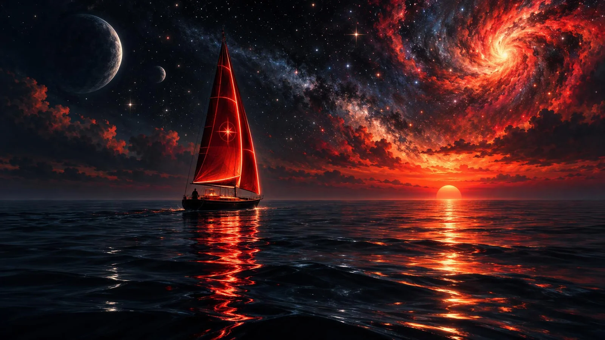

# Painterly Cosmic Ocean: Sailboat with Glowing Red Sail

**中文标题：** 绘画感宇宙之海：发光红帆小船  
**ID:** `gi25-x-1530` · **Mode:** `generate`  
**Categories:** `general`  
**Tags:** `x-twitter`, `community`, `gpt-image-2.5`, `x-direct`, `en`



### Painterly Cosmic Ocean: Sailboat with Glowing Red Sail

```text
Soft painterly digital illustration of A solitary sailboat navigates through a surreal, cosmic ocean under a vibrant, star-filled sky with sailboat, glowing red sail, cosmic sky, featuring Neon red outlines on the sail, Star-like particles in the sky, with Dramatic, internal glow from the sailboat's sail and reflections, with ambient light from a sunset or cosmic phenomena in the sky, limited deep blue, vibrant red, black, white, orange palette, and a minimalist composition with generous negative space
```

- **Recommended model:** `gpt-image-2.5-sunburst`
- **Settings:** _(defaults)_
- **Source:** [community](https://x.com/churvikv/status/2120936234608365748) — @churvikv
- **License note:** Original public X post; quoted with attribution — remix with attribution
- **Notes:** Collected directly from X; original post https://x.com/churvikv/status/2120936234608365748; post text names GPT Image 2.5; discovered via X search, prompt re-verified against the original X post via api.fxtwitter.com; verified=True; made on GMI Cloud with GPT Image 2.5 Sunburst
- **Preview:** `previews/gi25-x-1530.webp`
