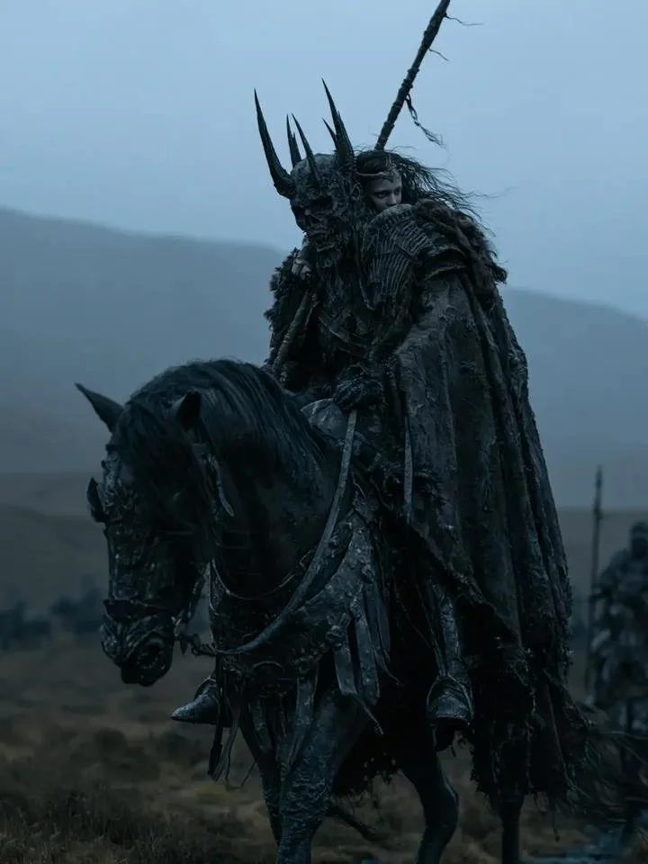

# Dark Fantasy Warrior on a Black Warhorse in Foggy Highlands

**中文标题：** 雾中高地黑马上的暗黑奇幻战士  
**ID:** `gi25-x-1531` · **Mode:** `generate`  
**Categories:** `general`  
**Tags:** `x-twitter`, `community`, `gpt-image-2.5`, `x-direct`, `en`



### Dark Fantasy Warrior on a Black Warhorse in Foggy Highlands

```text
A dark fantasy warrior riding a massive black warhorse through a foggy, desolate highland. The rider wears an elaborate spiked horned helmet with multiple sharp black spikes, a tattered dark cloak and fur mantle, heavy layered black armor.
```

- **Recommended model:** `gpt-image-2.5-sunburst`
- **Settings:** _(defaults)_
- **Source:** [community](https://x.com/Tuseefali47516/status/2120923212850581859) — @Tuseefali47516
- **License note:** Original public X post; quoted with attribution — remix with attribution
- **Notes:** Collected directly from X; original post https://x.com/Tuseefali47516/status/2120923212850581859; post text names GPT Image 2.5; discovered via X search, prompt re-verified against the original X post via api.fxtwitter.com; verified=True; author used GPT Image 2.5 in ChatGPT
- **Preview:** `previews/gi25-x-1531.webp`
