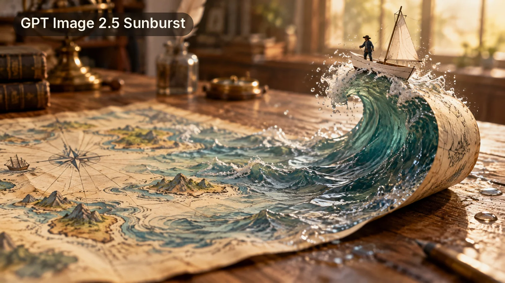

# Surreal Miniature Macro: Paper Map Waves Become Real Sea (16:9)

**中文标题：** 超现实微缩微距：航海图上的浪变成真海水（16:9）  
**ID:** `gi25-x-1534` · **Mode:** `generate`  
**Categories:** `general`  
**Tags:** `x-twitter`, `community`, `gpt-image-2.5`, `x-direct`, `en`



### Surreal Miniature Macro: Paper Map Waves Become Real Sea (16:9)

```text
Create a wide horizontal 16:9 surreal miniature macro photograph with no text, letters, or watermark. An old cream-colored hand-drawn nautical map lies across a wooden desk. On the left, the paper is flat, covered with delicate ink-and-watercolor illustrations of blue ocean waves, tiny islands and compass lines. Moving to the right, the drawn waves gradually turn into real, translucent sea water rising out of the paper, and the right edge of the map curls up into a large curling wave made of paper and water. A tiny white paper boat with a small sail rides the crest of the wave, a fingertip-sized sailor standing on its deck. Soft warm afternoon window light, sparkling water droplets, shallow depth of field, blurred study room bokeh background. Palette of cream, aged paper beige, teal and soft gold, fine paper texture, poetic and adventurous mood, like a real macro photo of a miniature scene.
```

- **Recommended model:** `gpt-image-2.5-sunburst`
- **Settings:** _(defaults)_
- **Source:** [community](https://x.com/matrixray_0616/status/2120790529667698986) — @matrixray_0616
- **License note:** Original public X post; quoted with attribution — remix with attribution
- **Notes:** Collected directly from X; prompt posted as the author's own reply https://x.com/matrixray_0616/status/2120790529667698986 to https://x.com/matrixray_0616/status/2120790464374669335, which carries the images; GPT Image 2.5 is named in the parent post; discovered via X search, prompt re-verified against the original X post via api.fxtwitter.com; verified=True; the parent post compares four models; image 1 is GPT Image 2.5 Sunburst and is used as the preview
- **Preview:** `previews/gi25-x-1534.webp`
