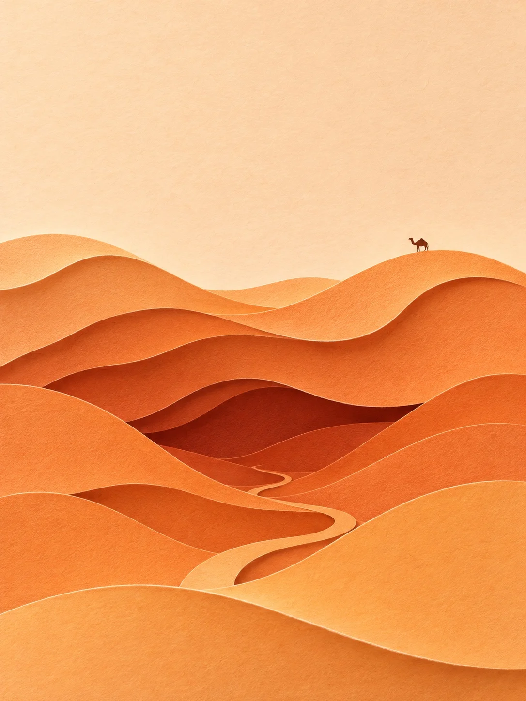

# Layered Paper-Cut Relief: Warm Dunes with a Tiny Camel (3:4)

**中文标题：** 分层纸雕立体插画：暖橙沙丘与小骆驼（3:4）  
**ID:** `gi25-x-1535` · **Mode:** `generate`  
**Categories:** `general`  
**Tags:** `x-twitter`, `community`, `gpt-image-2.5`, `x-direct`, `zh`



### Layered Paper-Cut Relief: Warm Dunes with a Tiny Camel (3:4)

```text
Create an image with the following visual system. Replace the subject as specified.

Visual system (light, color, composition, medium, mood):
【画面风格】一张竖幅约 3:4 的分层剪纸立体插画，所有形状都是同一个色相的纸片一层层叠出来的：从最浅的底纸到最深的内层，大约 7 到 9 层，每层边缘都是圆润起伏的曲线，层与层之间有清楚的柔和投影，能看见纸片的厚度和切口的一点白边。主体的大形由这些起伏的纸层自然塑出，只在高处放一个很小的、颜色对比的点睛物件。上方三分之一是干净的浅底纸，留作呼吸空间。光线从左上柔和照来，投影落在右下，内层的孔洞最暗。纸面有极细的纤维纹，不是塑料质感的 3D 渲染，不是矢量扁平，不是水彩。整张不写任何文字，没有水印。安静、干净、立体感强。

New subject:
【主体】暖橙色相的沙丘。纸层从浅杏色到深赭红，叠出一道道弯曲的沙脊，一条细细的沙路蜿蜒进内层。高处放一只很小的深棕色骆驼，只有一个小小的剪影。
```

- **Recommended model:** `gpt-image-2.5-sunburst`
- **Settings:** _(defaults)_
- **Source:** [community](https://x.com/static_stare/status/2121932376179880160) — @static_stare
- **License note:** Original public X post; quoted with attribution — remix with attribution
- **Notes:** Collected directly from X; original post https://x.com/static_stare/status/2121932376179880160; post text names GPT Image 2.5; discovered via X search, prompt re-verified against the original X post via api.fxtwitter.com; verified=True; visual-system + replaceable-subject template; prompt for image 1 of 4 (the author offers the other three on request); post names GPT Image 2.5 without a Flare/Sunburst variant; preview is image 1
- **Preview:** `previews/gi25-x-1535.webp`
