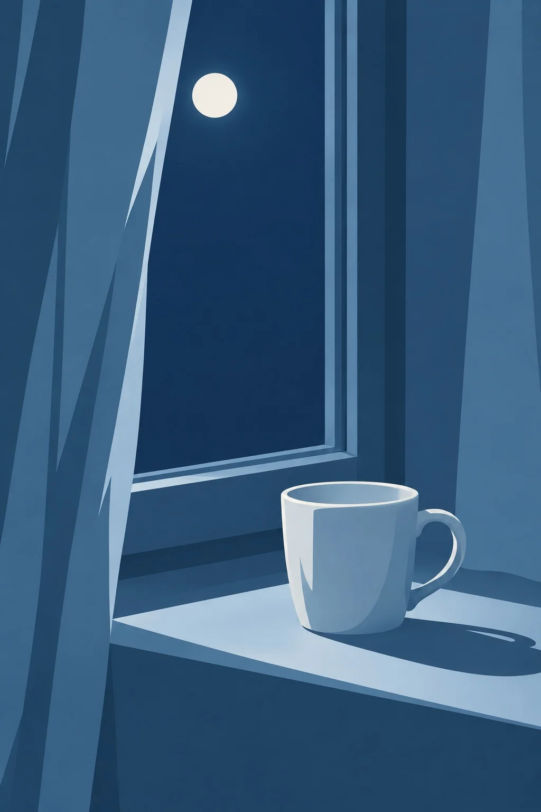

# Monochrome Blue Flat Illustration: White Cup on a Night Windowsill (2:3)

**中文标题：** 单色蓝平涂：夜晚窗台上的白瓷杯（2:3）  
**ID:** `gi25-x-1536` · **Mode:** `generate`  
**Categories:** `general`  
**Tags:** `x-twitter`, `community`, `gpt-image-2.5`, `x-direct`, `zh`



### Monochrome Blue Flat Illustration: White Cup on a Night Windowsill (2:3)

```text
Create an image with the following visual system. Replace the subject as specified.

Visual system (light, color, composition, medium, mood):
【画面风格】一张竖幅约 2:3 的单色平涂插画，近景或中近景，夜里的室内或窗边。全画面只有一个蓝色系加一点象牙白：主色是饱和度不高的深蓝到青蓝，受光面是浅象牙或很淡的蓝白，没有黄色、没有橙色、没有绿色，不要补一盏暖色灯。形体用干净的平涂色块和硬边阴影来分面，阴影边缘清楚，不要柔焦，不要厚涂笔触，不要照片颗粒。构图靠近主体，画面里东西很少，大面积是安静的墙、窗帘或桌面。光线来自窗外的月光或一处很弱的冷白光，亮度对比中等，暗部仍能看出形，不要死黑。画面无文字、无签名、无水印，器物上不要可读的字。安静、发冷，像夜里只剩一种颜色的房间。

New subject:
【主体】窗台上放着一只白瓷杯，杯子的受光面是象牙白，窗外是深蓝的夜，窗帘拉开一条缝，冷光照在杯沿和窗台上。没有人。画面中没有文字。
```

- **Recommended model:** `gpt-image-2.5-sunburst`
- **Settings:** _(defaults)_
- **Source:** [community](https://x.com/static_stare/status/2121243929358237871) — @static_stare
- **License note:** Original public X post; quoted with attribution — remix with attribution
- **Notes:** Collected directly from X; original post https://x.com/static_stare/status/2121243929358237871; post text names GPT Image 2.5; discovered via X search, prompt re-verified against the original X post via api.fxtwitter.com; verified=True; visual-system + replaceable-subject template; prompt for image 1 of 4 (the author offers the other three on request); post names GPT Image 2.5 without a Flare/Sunburst variant; preview is image 1
- **Preview:** `previews/gi25-x-1536.webp`
